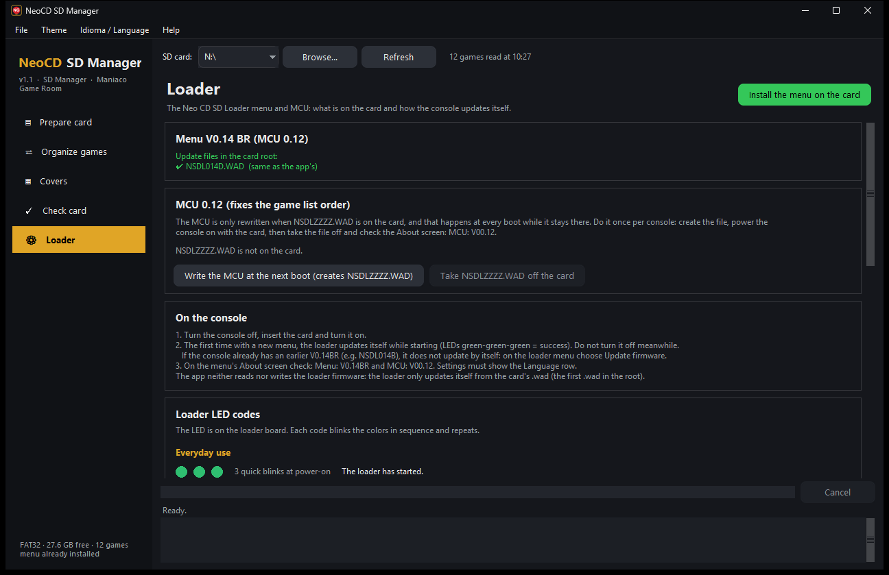
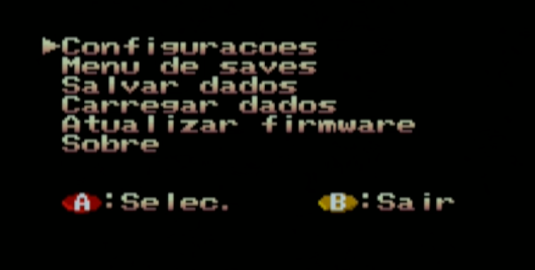

# How to write the firmware on the Neo CD SD Loader

**[Português](FIRMWARE.md)** · [App manual](MANUAL.en.md)

This guide explains how the **Neo CD SD Loader** writes the **V0.14 BR** menu (file **`NSDL014D.WAD`**) and **MCU 0.12** from the SD card, what to do at each step and what each LED color means. You do not need to open the console or use a programmer: everything is done through the card.

> Keep the console powered steadily while writing. **Do not turn the console off while the LED is blinking blue.**

The menu starts in Portuguese. The English names are shown in brackets: **Sobre** (About), **Configuracoes** (Settings), **Atualizar firmware** (Update firmware).

**Which case is mine?**

- The loader **does not have the BR menu yet**, or has a menu of another version (the **Sobre**/About screen does not show `Menu: V0.14BR`): follow [step 3](#3-first-write). Writing starts by itself at power-on.
- The loader **already has the V0.14BR menu** from an earlier release (`NSDL014B` or `NSDL014C`): follow [step 4](#4-updating-a-console-that-already-has-v014br). Since the version number is the same, the loader does **not** update by itself: you write it with the menu option **Atualizar firmware** (Update firmware).

---

## 1. What gets written

The loader has three rewritable parts. They all come from the same update file, **`NSDL014D.WAD`**, which the app copies to the card root:

| Part | What it is | When it is written |
|---|---|---|
| **Menu** | The loader's flash memory: your console's BIOS with the loader patch and the Portuguese/English menu | At power-on, if the stored version differs from the one the MCU expects, or with the menu option **Atualizar firmware** (Update firmware) |
| **CPLD** | The board's logic chip | Together with the menu, when the CPLD version differs |
| **MCU** | The microcontroller that reads the SD card | **Only** when there is an **`NSDLZZZZ.WAD`** in the card root (the app creates this file if you ask) |

While writing the menu, the loader saves a copy of the console's BIOS to the card, **`ROMDUMP.BIN`** (512 KB), and builds the menu from it. That file is **your** console's BIOS: keep it, but do not share it.

**New in `NSDL014D`:** a **Language** row in **Settings** (PT-BR, the default, or English); the cover hides while the options menu is open and does not flicker when you go back; when you go back with **B**, the cursor stays on the same game; long names scroll in a loop. The **About** screen still shows `Menu: V0.14BR`: the way to tell 014D is installed is the **Language** row in **Settings**.

## 2. Before you start

- An SD card in **FAT32**, with free space (at least 1 MB for `ROMDUMP.BIN`).
- To write, use a card of **up to 32 GB**. In one test with a 64 GB card the write failed and the console fell back to its original CD screen; with a 32 GB card and the same file it worked. After writing, you can go back to your usual card.
- The **NeoCD SD Manager** app, 1.1 or newer ([Releases](../../releases)), which already carries `NSDL014D.WAD`.
- On the **Sobre** (About) screen of the current menu, note the **MENU** and **MCU** versions. If the MCU is already **V00.12**, you can skip the MCU part.

## 3. First write

### 3.1 On the PC

1. Put the card in the PC and open the app.
2. On the **Prepare card** page, tick **1. Install the V0.14 BR (MCU 0.12) menu on the card (NSDL014D.WAD)**.
3. If the console's MCU is not V00.12 yet, also tick **Also write the new MCU to the console**. You can do the same on the **Loader** page → **Write the MCU at the next boot (creates NSDLZZZZ.WAD)**.
4. Click **Prepare card**. The app copies `NSDL014D.WAD` (and `NSDLZZZZ.WAD`, if you ticked it), checks each copy byte by byte and moves any other `.wad` to the backup.



The card root looks like this:

```
E:\
├─ NSDL014D.WAD     V0.14 BR menu + MCU 0.12
├─ NSDLZZZZ.WAD     only if you asked for the MCU write
└─ (the game folders)
```

### 3.2 On the console

1. With the console **off**, insert the card in the loader and turn it on.
2. If `NSDLZZZZ.WAD` is on the card, the MCU is written first: the LED **blinks blue** and ends with **3 slow green blinks** (success).
3. Right after that, the loader gives **3 quick green blinks** (it has started) and, if the menu or the CPLD need an update, the LED **blinks blue** again while writing. Wait: it takes a few seconds.
4. The loader menu shows up. Open **Sobre** (About) and check **MENU: V0.14BR** and **MCU: V00.12**; **Configuracoes** (Settings) must show the **Idioma** (Language) row.


### 3.3 After the first boot

1. Turn the console off, put the card back in the PC and **remove `NSDLZZZZ.WAD`**: while it stays on the card, the MCU is rewritten at every boot. In the app: **Loader** page → **Take NSDLZZZZ.WAD off the card** (if you forget, the app moves it to the backup the next time it prepares the card).
2. `NSDL014D.WAD` can stay on the card: the loader only rewrites the menu when the version changes or when you ask it to.

## 4. Updating a console that already has V0.14BR

For those who already use the BR menu (`NSDL014B` or `NSDL014C`) and want what is new in `NSDL014D`:

1. **On the PC:** open the app, choose the card and click **Install the menu on the card** (**Loader** page) or **Prepare card** with step 1 ticked. The old `.wad` goes to the backup and `NSDL014D.WAD` is left alone in the root. If the MCU is already V00.12, do not create `NSDLZZZZ.WAD`.
2. **On the console:** turn it on with the card. The old menu opens as usual (there is no automatic write, because the version is the same).
3. On the loader's main menu, choose **Atualizar firmware** (Update firmware). The LED **blinks blue** while the loader writes the CPLD and the menu. **Do not turn it off.**
4. When it is done, the loader restarts by itself and opens the new menu. Check the **Idioma** (Language) row in **Configuracoes** (Settings).



## 5. If something goes wrong

**"SEM ARQUIVO DE UPDATE" (NO UPDATE FILE) shows up.** The loader did not find the `.wad` in the root: install the menu again with the app.

**The console opened its original CD screen, without the loader.** Writing the menu failed with a file error (reading the `.wad` or writing `ROMDUMP.BIN`). Turn it off, switch to a FAT32 card of **up to 32 GB**, install the menu on it with the app and try again. If the LED showed a code before that, see the table below.

**The menu did not update by itself at power-on.** That is normal when the console already has a V0.14BR: use **Atualizar firmware** (Update firmware) ([step 4](#4-updating-a-console-that-already-has-v014br)). Also check that `NSDL014D.WAD` is the **only** `.wad` in the root (the loader uses the first one it finds, whatever its name; `NSDLZZZZ.WAD`, when present, has the same content).

**The LED blinks blue every time I power on.** `NSDLZZZZ.WAD` is still on the card. Remove it (step 3.3).

**The About screen shows an MCU older than V00.12.** Write the MCU (step 3.1, item 3): the V0.14 BR menu was made for MCU 0.12.

## 6. LED codes

The LED is on the loader board. An error code blinks three colors in sequence (0.25 s each) and pauses. The codes below were read from the loader firmware. The same table is in the app, on the **Loader** page.

### Everyday use

| LED | How it shows | Meaning |
|---|---|---|
| 🟢🟢🟢 | 3 quick blinks at power-on | The loader has started. |
| 🟢 | steady | On, not reading the card (default color). |
| 🟡 | steady or blinking | Reading or writing the card: loading the game or saving (default color). |
| 🔵 | blinking | Writing an update (MCU, CPLD or menu). **Do not turn it off.** |
| 🟢🟢🟢 | 3 slow blinks | MCU written and verified. Remove `NSDLZZZZ.WAD` from the card. |

### Error writing the MCU (the code repeats endlessly)

| LED | Meaning | What to do |
|---|---|---|
| 🔴🔴🟡 | Could not open the `.wad` file. | Install the menu again with the app and check that the card is FAT32. |
| 🔴🟡🔴 | The `.wad` is corrupt or not a loader file. | Install the menu again with the app. |
| 🔴🟡🟡 | Could not erase the MCU memory. | Turn it off and on again. If it repeats, the MCU has to be reflashed over USB. |
| 🟡🔴🔴 | Writing the MCU memory failed. | Turn it off and on again. If it repeats, the MCU has to be reflashed over USB. |
| 🟡🔴🟡 | Could not read the `.wad` again to verify the write. | Copy the `.wad` again or use another card. |
| 🟡🟡🔴 | Verification failed: what was written does not match the `.wad`. | Turn it off and on again. If it repeats, the MCU has to be reflashed over USB. |
| 🔴🔴🔴 then steady 🔴 | The MCU program is damaged and there is no `.wad` on the card: the loader entered USB recovery mode (DFU). | Insert a card with the menu installed and power on again. |

### Error updating the menu or the CPLD

Shown **once**; then the console opens the normal CD menu, without the loader.

| LED | Meaning | What to do |
|---|---|---|
| 🔴🔴🔴 | An update was needed, but there is no `.wad` in the card root. | Install the menu on the card with the app. |
| 🟡🔴🔴 | Writing the CPLD failed. | Turn it off and on again: the loader retries at every boot. |
| 🟡🔴🟡 | File error reading the `.wad` or writing `ROMDUMP.BIN` to the card. | Check that the card has free space, use a card of up to 32 GB and try again. |
| 🟡🟡🟡 | The `.wad` has no patch for this console's BIOS. | This menu does not support that BIOS. Keep the `ROMDUMP.BIN` from the card and open an [Issue](../../issues). |

The everyday 🟢 and 🟡 colors are the defaults. You can change them in the menu, under **Configuracoes** (Settings) → **LED Ocioso** (idle LED) and **LED Carreg.** (loading LED).

---

The loader firmware (MCU, CPLD and menu) is by **Furrtek**, free software (GPL) — [furrtek.org/sdloader](http://www.furrtek.org/sdloader/). The BR edition is distributed through [NeoCD SD Manager](https://github.com/maniaco007/NeoCD-SD-Manager). Use at your own risk.
