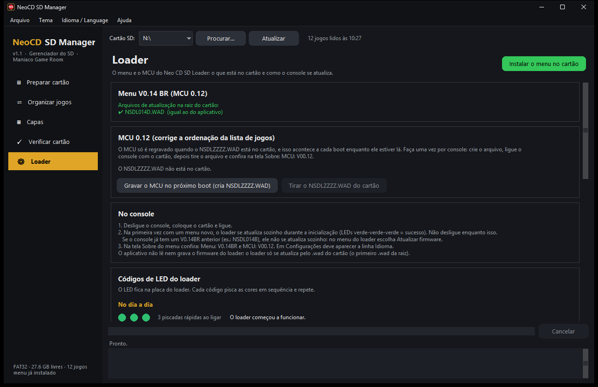
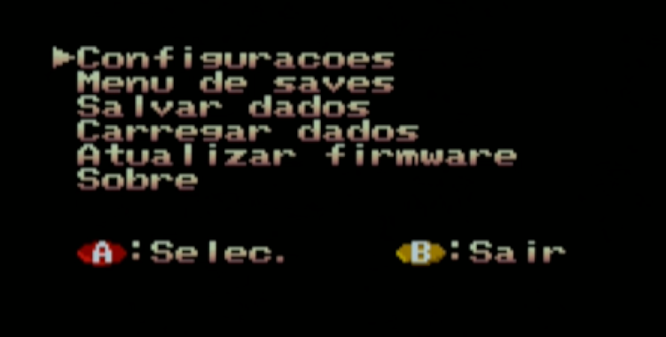

# Como gravar o firmware no Neo CD SD Loader

**[English](FIRMWARE.en.md)** · [Manual do aplicativo](MANUAL.md)

Este guia explica como o **Neo CD SD Loader** grava o menu **V0.14 BR** (arquivo **`NSDL014D.WAD`**) e o **MCU 0.12** a partir do cartão SD, o que fazer em cada passo e o que significa cada cor do LED. Não é preciso abrir o console nem usar gravador: tudo é feito pelo cartão.

> Faça a gravação com o console ligado na tomada de forma estável. **Não desligue o console enquanto o LED estiver piscando em azul.**

**Qual é o meu caso?**

- O loader **ainda não tem o menu BR**, ou tem um menu de outra versão (a tela **Sobre** não mostra `Menu: V0.14BR`): siga o [passo 3](#3-primeira-gravação). A gravação começa sozinha ao ligar.
- O loader **já tem o menu V0.14BR** de uma versão anterior (`NSDL014B` ou `NSDL014C`): siga o [passo 4](#4-atualizar-um-console-que-já-tem-o-v014br). Como o número da versão é o mesmo, o loader **não** se atualiza sozinho: a gravação é pela opção **Atualizar firmware** do menu.

---

## 1. O que é gravado

O loader tem três partes regraváveis. Todas vêm do mesmo arquivo de atualização, **`NSDL014D.WAD`**, que o aplicativo copia para a raiz do cartão:

| Parte | O que é | Quando é gravada |
|---|---|---|
| **Menu** | A memória flash do loader: a BIOS do seu console com a correção do loader e o menu em português/inglês | Ao ligar, se a versão gravada for diferente da que o MCU espera, ou pela opção **Atualizar firmware** do menu |
| **CPLD** | O chip de lógica da placa | Junto com o menu, quando a versão do CPLD for diferente |
| **MCU** | O microcontrolador que lê o cartão SD | **Só** quando existe um **`NSDLZZZZ.WAD`** na raiz do cartão (o aplicativo cria esse arquivo se você pedir) |

Durante a gravação do menu, o loader faz uma cópia da BIOS do console no cartão, o arquivo **`ROMDUMP.BIN`** (512 KB), e usa essa cópia para montar o menu. Esse arquivo é a BIOS do **seu** console: guarde-o, mas não o distribua.

**O que há de novo no `NSDL014D`:** a linha **Idioma** em **Configurações** (PT-BR, o padrão, ou English); a capa some enquanto o menu de opções está aberto e não pisca ao voltar; ao voltar com **B**, o cursor continua no mesmo jogo; nomes longos rolam em loop. A tela **Sobre** continua mostrando `Menu: V0.14BR`: o jeito de saber que o 014D está gravado é ver a linha **Idioma** em **Configurações**.

## 2. Antes de começar

- Cartão SD em **FAT32**, com espaço livre (pelo menos 1 MB para o `ROMDUMP.BIN`).
- Para gravar, use um cartão de **até 32 GB**. Num teste com um cartão de 64 GB a gravação falhou e o console voltou para a tela original de CD; com um de 32 GB e o mesmo arquivo, funcionou. Depois de gravar, você pode voltar ao cartão de sempre.
- O aplicativo **NeoCD SD Manager** 1.1 ou mais novo ([Releases](../../releases)), que já traz o `NSDL014D.WAD`.
- Na tela **Sobre** do menu atual, anote as versões de **MENU** e **MCU**. Se o MCU já for **V00.12**, você pode pular a parte do MCU.

## 3. Primeira gravação

### 3.1 No PC

1. Coloque o cartão no PC e abra o aplicativo.
2. Na tela **Preparar cartão**, marque **1. Instalar o menu V0.14 BR (MCU 0.12) no cartão (NSDL014D.WAD)**.
3. Se o MCU do console ainda não for V00.12, marque também **Também gravar o MCU novo no console**. Você também pode fazer isso na tela **Loader** → **Gravar o MCU no próximo boot (cria NSDLZZZZ.WAD)**.
4. Clique em **Preparar cartão**. O aplicativo copia o `NSDL014D.WAD` (e o `NSDLZZZZ.WAD`, se você marcou), confere cada cópia byte a byte e move qualquer outro `.wad` para o backup.



A raiz do cartão fica assim:

```
E:\
├─ NSDL014D.WAD     menu V0.14 BR + MCU 0.12
├─ NSDLZZZZ.WAD     só se você pediu a gravação do MCU
└─ (as pastas dos jogos)
```

### 3.2 No console

1. Com o console **desligado**, coloque o cartão no loader e ligue.
2. Se o `NSDLZZZZ.WAD` estiver no cartão, o MCU é gravado primeiro: o LED **pisca em azul** e termina com **3 piscadas verdes lentas** (deu certo).
3. Logo depois, o loader dá **3 piscadas verdes rápidas** (começou a funcionar) e, se o menu ou o CPLD precisarem de atualização, o LED volta a **piscar em azul** enquanto grava. Espere: leva alguns segundos.
4. O menu do loader aparece. Abra **Sobre** e confira **MENU: V0.14BR** e **MCU: V00.12**; em **Configurações** deve aparecer a linha **Idioma**.


### 3.3 Depois do primeiro boot

1. Desligue o console, volte o cartão ao PC e **tire o `NSDLZZZZ.WAD`**: enquanto ele estiver no cartão, o MCU é regravado a cada boot. No aplicativo: tela **Loader** → **Tirar o NSDLZZZZ.WAD do cartão** (se você esquecer, o aplicativo o move para o backup na próxima vez que preparar o cartão).
2. O `NSDL014D.WAD` pode ficar no cartão: o loader só regrava o menu quando a versão muda ou quando você pede.

## 4. Atualizar um console que já tem o V0.14BR

Para quem já usa o menu BR (`NSDL014B` ou `NSDL014C`) e quer as novidades do `NSDL014D`:

1. **No PC:** abra o aplicativo, escolha o cartão e clique em **Instalar o menu no cartão** (tela **Loader**) ou em **Preparar cartão** com o passo 1 marcado. O `.wad` antigo vai para o backup e o `NSDL014D.WAD` fica sozinho na raiz. Se o MCU já é V00.12, não crie o `NSDLZZZZ.WAD`.
2. **No console:** ligue com o cartão. O menu antigo abre normalmente (não há gravação automática, porque a versão é a mesma).
3. No menu principal do loader, escolha **Atualizar firmware**. O LED **pisca em azul** enquanto o loader grava o CPLD e o menu. **Não desligue.**
4. Quando termina, o loader reinicia sozinho e abre o menu novo. Confira em **Configurações** a linha **Idioma**.



## 5. Se algo der errado

**Apareceu "SEM ARQUIVO DE UPDATE".** O loader não achou o `.wad` na raiz: instale o menu de novo pelo aplicativo.

**O console abriu a tela original de CD, sem o loader.** A gravação do menu falhou por erro de arquivo (leitura do `.wad` ou escrita do `ROMDUMP.BIN`). Desligue, troque por um cartão FAT32 de **até 32 GB**, instale o menu nele pelo aplicativo e tente de novo. Se o LED mostrou um código antes disso, veja a tabela abaixo.

**O menu não atualizou sozinho ao ligar.** É o normal quando o console já tem um V0.14BR: use **Atualizar firmware** ([passo 4](#4-atualizar-um-console-que-já-tem-o-v014br)). Confira também que o `NSDL014D.WAD` é o **único** `.wad` na raiz (o loader usa o primeiro que encontrar, qualquer nome; o `NSDLZZZZ.WAD`, quando existe, tem o mesmo conteúdo).

**O LED pisca em azul a cada vez que ligo.** O `NSDLZZZZ.WAD` continua no cartão. Tire-o (passo 3.3).

**A tela Sobre mostra um MCU anterior a V00.12.** Faça a gravação do MCU (passo 3.1, item 3): o menu V0.14 BR foi feito para o MCU 0.12.

## 6. Códigos de LED

O LED fica na placa do loader. Um código de erro pisca três cores em sequência (0,25 s cada) e faz uma pausa. Os códigos abaixo foram tirados do firmware do loader. A mesma tabela está no aplicativo, na tela **Loader**.

### No dia a dia

| LED | Como aparece | O que significa |
|---|---|---|
| 🟢🟢🟢 | 3 piscadas rápidas ao ligar | O loader começou a funcionar. |
| 🟢 | aceso | Ligado, sem ler o cartão (cor padrão). |
| 🟡 | aceso ou piscando | Lendo ou gravando no cartão: carregando o jogo ou salvando (cor padrão). |
| 🔵 | piscando | Gravando uma atualização (MCU, CPLD ou menu). **Não desligue.** |
| 🟢🟢🟢 | 3 piscadas lentas | MCU gravado e conferido. Tire o `NSDLZZZZ.WAD` do cartão. |

### Erro ao gravar o MCU (o código se repete sem parar)

| LED | O que significa | O que fazer |
|---|---|---|
| 🔴🔴🟡 | Não conseguiu abrir o arquivo `.wad`. | Instale o menu de novo pelo aplicativo e confira se o cartão é FAT32. |
| 🔴🟡🔴 | O `.wad` está corrompido ou não é do loader. | Instale o menu de novo pelo aplicativo. |
| 🔴🟡🟡 | Não conseguiu apagar a memória do MCU. | Desligue e ligue de novo. Se repetir, o MCU precisa ser regravado por USB. |
| 🟡🔴🔴 | Falhou ao gravar a memória do MCU. | Desligue e ligue de novo. Se repetir, o MCU precisa ser regravado por USB. |
| 🟡🔴🟡 | Não conseguiu reler o `.wad` para conferir a gravação. | Copie o `.wad` de novo ou troque o cartão. |
| 🟡🟡🔴 | A conferência falhou: o que foi gravado não bate com o `.wad`. | Desligue e ligue de novo. Se repetir, o MCU precisa ser regravado por USB. |
| 🔴🔴🔴 e depois 🔴 aceso | O programa do MCU está danificado e não há `.wad` no cartão: o loader entrou no modo de recuperação por USB (DFU). | Ponha um cartão com o menu instalado e ligue de novo. |

### Erro ao atualizar o menu ou o CPLD

Aparece **uma vez**; depois o console abre o menu normal de CD, sem o loader.

| LED | O que significa | O que fazer |
|---|---|---|
| 🔴🔴🔴 | Precisava atualizar, mas não há `.wad` na raiz do cartão. | Instale o menu no cartão pelo aplicativo. |
| 🟡🔴🔴 | Falhou ao gravar o CPLD. | Desligue e ligue de novo: o loader tenta de novo a cada boot. |
| 🟡🔴🟡 | Erro de arquivo ao ler o `.wad` ou ao gravar o `ROMDUMP.BIN` no cartão. | Confira se há espaço livre, use um cartão de até 32 GB e tente de novo. |
| 🟡🟡🟡 | O `.wad` não tem correção para a BIOS deste console. | Este menu não suporta essa BIOS. Guarde o `ROMDUMP.BIN` do cartão e abra uma [Issue](../../issues). |

As cores 🟢 e 🟡 do dia a dia são as padrão. Você pode trocá-las no menu, em **Configurações** → **LED Ocioso** e **LED Carreg.**

---

O firmware do loader (MCU, CPLD e menu) é de **Furrtek**, software livre (GPL) — [furrtek.org/sdloader](http://www.furrtek.org/sdloader/). A edição BR é distribuída pelo [NeoCD SD Manager](https://github.com/maniaco007/NeoCD-SD-Manager). Use por sua conta e risco.
