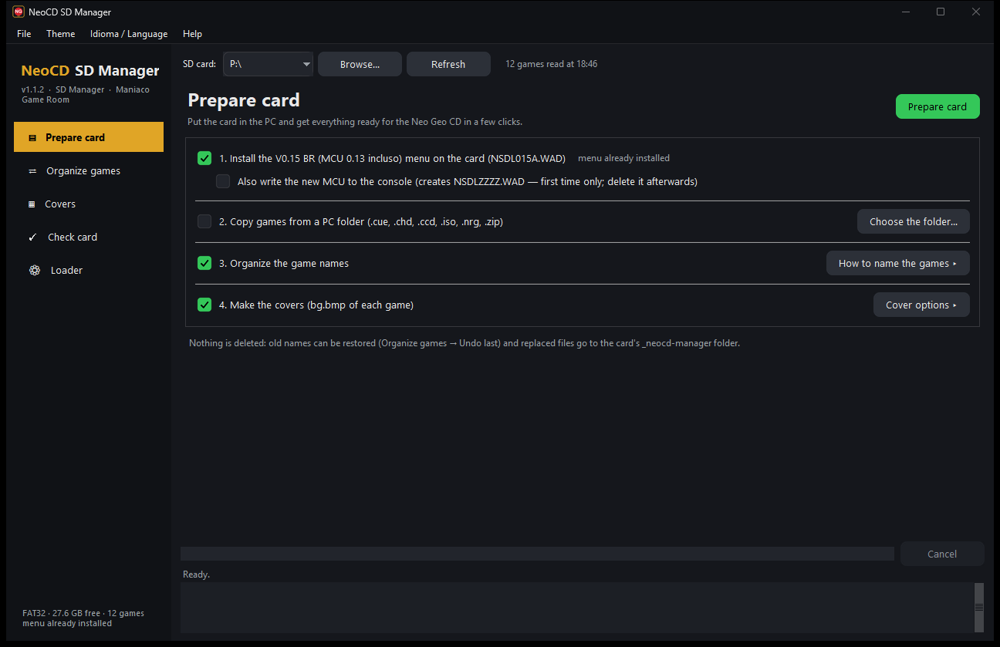
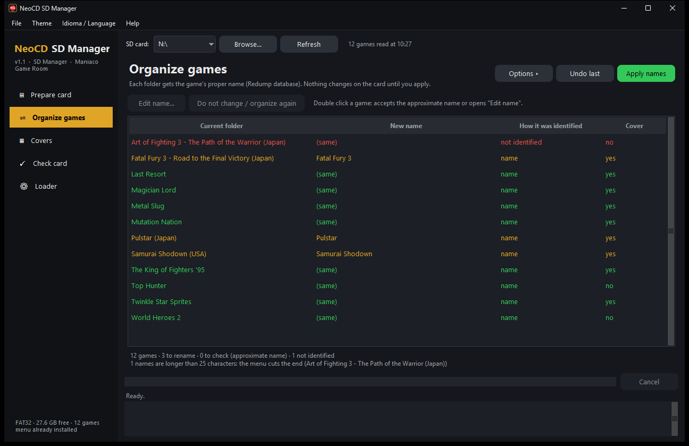

# NeoCD SD Manager — Manual

**[Versão em português](MANUAL.md)**

NeoCD SD Manager gets the SD card of your **Neo Geo CD with the Neo CD SD Loader (BR Edition)** ready in a few clicks: it installs the menu, organizes the game names and makes the cover of each game.

A project of the **[Maniaco Game Room](https://www.maniacogameroom.com.br/)** blog.

---

## Contents

1. [Before you start](#1-before-you-start)
2. [The app window](#2-the-app-window)
3. [Prepare card](#3-prepare-card)
4. [Games and covers](#4-games-and-covers)
5. [On the console](#5-on-the-console)
6. [What goes where on the card](#6-what-goes-where-on-the-card)
7. [Troubleshooting](#7-troubleshooting)
8. [Credits](#8-credits)

---

## 1. Before you start

**You need:**

- A **Neo Geo CD** with the **Neo CD SD Loader** installed (Furrtek's mod kit, top-loading or front-loading version).
- A computer running **Windows 10 or 11**.
- An **SD card formatted as FAT32**. The loader does not read exFAT or NTFS; the app warns you if the card uses another format.
- Your games on the card, **each one in its own folder in the root** containing the **`.cue`** file (plus the `.bin`/`.iso` and audio tracks the `.cue` refers to). That is how the menu sees games: it lists the folders that contain a `.cue`. The menu shows at most **200 games**.
- **Internet** the first time: the app downloads the name database (Redump) and the covers. They are then kept on the PC, in `%LOCALAPPDATA%\NeoCD-SD-Manager`.

**Installation:** there is none. Download `NeoCD-SD-Manager.exe` from the [Releases](../../releases) page and open it.

> The first time, Windows may show "Windows protected your PC" (SmartScreen), because the program is new and has no paid signature. Click **More info → Run anyway**.

**Your card is safe:** the app **deletes nothing**. It only (1) copies the menu file, (2) renames game folders — keeping a log so it can be undone — and (3) writes a `bg.bmp` file inside each game's folder. Everything replaced goes to `_neocd-manager/backup`. Still, make a copy of the card before the first run.

**What the app does not do:** it does not provide games or BIOS files, does not convert disc formats (loose ISO, CHD, etc.) and does not create a `.cue` that does not exist.

---

## 2. The app window



- **SD card** (top): choose the card's drive letter. Removable drives are listed; if yours is missing, use **Browse…** and pick the card root. Next to it the app shows the file system, free space and how many games it found (in red if not FAT32).
- **Tabs:** *Prepare card* and *Games and covers*.
- **Footer:** current step, progress, estimated time and the **Cancel** button. Below is the **report** of what was done, with warnings.
- **File menu:** opens the card in Explorer.
- **Theme menu:** window colors (Night, Light, Neo Geo, CRT screen). Your choice is saved.
- **Idioma / Language menu:** window in Portuguese or English. The first time it uses the Windows language.
- **Help menu:** Maniaco Game Room blog, project page and About.

---

## 3. Prepare card

This is the main tab: tick what you want and click **Prepare card**. Each step works on its own.

### Step 1 — Install the menu

Copies the update file **`NSDL0014.WAD`** (menu **V0.14 BR**) to the card root and verifies the copy byte by byte (CRC32) before finishing.

- The loader uses the **first `.wad`** it finds in the root. So if the card has another `.wad`, the app **moves it to the backup** (it does not delete it).
- The app **writes nothing to the console**. The update happens on the console when you power it on with the card: if the installed menu/CPLD versions differ from the file's, the loader updates itself; if they already match, nothing happens.
- Next to the step the app shows whether the menu is already on the card.

### Step 2 — Organize the game names

Reads the game folders on the card and renames each one with the proper title.

**How a game is identified:**

1. By the **folder name**, compared with the Neo Geo CD Redump database (ignores `[!]`, `_`, case, "The", regions…). The database holds both the Western and the Japanese title of each game, and either is accepted. Sequels are never mixed up ("Fatal Fury 3" never becomes "Fatal Fury 2").
2. If the name is not enough — or if you tick **Check by disc content (CRC)** — by the **CRC of the data track** (Track 01) compared with the database. It is safer but slow: it must read the whole file of every game (hundreds of MB), so the time depends on the card speed. The result is cached, so a second pass is fast. The comparison only works for Redump-style dumps (2352-byte-sector `.bin`).
3. If nothing matches, the folder **keeps its name** and appears in the report as *not identified*.

**Name style:**

- **Short title (default):** the Western title, without tags. E.g. `Garou Densetsu 2 ~ Fatal Fury 2 (Japan) (En,Ja)` → `Fatal Fury 2`. If two folders would get the same name, the region is added: `Fatal Fury 2 (Japan)` and `Fatal Fury 2 (USA)`.
- **Full official name:** the Redump database name, as it is.

Names are written in **plain ASCII** (no accents or special symbols), because the loader uses code page 850 for file names. Only the **folder** is renamed: the files inside (`.cue`, `.bin`, `.wav`) are **not touched**, so the `.cue` references stay valid. A folder never overwrites another: if the name already exists it is skipped and the report says so.

### Step 3 — Make the covers

Creates a **`bg.bmp`** in each game's folder — the cover the menu shows next to the list.

- **Image source, in order:** (1) your own image folder (**My images**), if you set one; (2) the internet — the app downloads the game's cover from libretro-thumbnails.
- **My images:** any folder with `.png`, `.jpg`, `.webp` or `.bmp` files. The file must have the **same name as the game** (the folder's or the official title), e.g. `Fatal Fury 2.png`.
- **Image fit:** *Stretch* (default, shows the whole image), *Fill* (crops the edges), *Whole image on a blurred backdrop* or *Whole image with black borders*.
- **Redo the ones that already exist:** by default, games that already have a `bg.bmp` are skipped. If ticked, the old `bg.bmp` goes to `_neocd-manager/backup/<date>` and is redone.
- The format is the menu's: **128 × 128**, 4 bits per pixel, up to 8 palettes of 15 colors (color 0 is transparent on the Neo Geo), 5 bits per color channel. Colors are reduced — so check the **preview** in the *Games and covers* tab.

At the end you get a summary: folders renamed, covers made, games without a cover, games not identified and warnings (e.g. a file the `.cue` mentions that does not exist — the game would not load).

---

## 4. Games and covers



To see and check everything **before** changing anything:

1. **Analyze card:** lists every game with the current name, the **new name**, *how it was identified* (name, approximate name, content/CRC or not identified) and whether it already has a cover. Orange = will be renamed; green = already right; red = not identified or with a missing file.
2. **Apply names:** renames the folders (with confirmation). The log is kept in `_neocd-manager/desfazer.json`.
3. **Undo last:** puts the folders of the last batch back to their previous names.
4. **Make covers:** creates the `bg.bmp` files for the listed games, with the options from the *Prepare card* tab.
5. **Preview:** click a game to see its cover **as the console will show it** (reduced colors and palettes), plus where the image came from.

A name marked **approximate** means the folder title did not match the database exactly; check it before applying.

---

## 5. On the console

1. Power off the console, insert the card into the SD Loader and power on.
2. The first time with the new menu, the loader updates itself during start-up (see the LED codes in [Furrtek's documentation](http://www.furrtek.org/sdloader/): green-green-green means success). Do not power off during the update.
3. In the game list the titles appear with the organized names.
4. When you rest the cursor on a game for a moment, its **cover** (the `bg.bmp` in the game's folder) shows in the box next to the list.

---

## 6. What goes where on the card

```
/                         card root (FAT32)
├─ NSDL0014.WAD           menu V0.14 BR (only needs to stay until the console updates)
├─ Fatal Fury 2/          one folder per game
│   ├─ game.cue           the menu lists folders that hold a .cue
│   ├─ game.bin           (disc files: never changed)
│   └─ bg.bmp             cover made by the app
└─ _neocd-manager/        created by the app
    ├─ desfazer.json      log of renamed folders (for "Undo last")
    └─ backup/<date>/     .wad and bg.bmp files that were replaced
```

The app keeps its settings and the database/cover cache in `%LOCALAPPDATA%\NeoCD-SD-Manager`.

---

## 7. Troubleshooting

**"The card is NTFS/exFAT — must be FAT32".** The loader only reads FAT32. Copy the files to the PC, format the card as FAT32 (for large cards use a FAT32 formatting tool) and copy them back.

**A game is "not identified".** The folder name matches no game in the database (it may be a homebrew, a hack or a very different name). Rename the folder with the game's name and analyze again, or tick **Check by disc content (CRC)**. Unidentified games keep their name and can still get a cover if you put an image with the same name in the *My images* folder.

**A game has "no cover".** There is no cover for that game in libretro-thumbnails. Put your own image, named like the game, in the *My images* folder.

**The cover looks bad or has odd colors.** The menu only shows 15 colors per 16×16-pixel block; very dark covers or gradients suffer. Try another *Image fit*, use a simpler image of your own and tick *Redo*.

**The game does not show in the menu.** Check that (1) the folder is in the card root, (2) it has a `.cue` inside, (3) the report did not warn about a missing file and (4) the card does not exceed 200 games.

**The console did not update the menu.** The loader only uses the **first `.wad`** in the root — there must be only one. And it only updates if the versions differ. Consoles with a loader older than version 0.6 must use the *Update firmware* option of the menu (see Furrtek's documentation).

**Windows blocked the program / the antivirus complained.** The `.exe` is new and has no paid signature; programs packaged this way sometimes trigger false alarms. The menu source code is on GitHub and the `.exe` can be checked against the hash published on the release page.

**Found another problem?** Open an [Issue](../../issues) with the report text.

---

## 8. Credits

- **Neo CD SD Loader** (original hardware, firmware and menu): Furrtek — [furrtek.org/sdloader](http://www.furrtek.org/sdloader/)
- **BR Edition** (Portuguese menu, covers, dynamic background): Maniaco Game Room — [menu source code](https://github.com/maniaco007/NeoCDSDLoader-BR-Edition)
- Covers: [libretro-thumbnails](https://github.com/libretro-thumbnails) · Game databases (Redump): [libretro-database](https://github.com/libretro/libretro-database)
- `.exe` components: Python, Tcl/Tk, Pillow, NumPy and Nuitka (licenses in [TERCEIROS.md](TERCEIROS.md))
