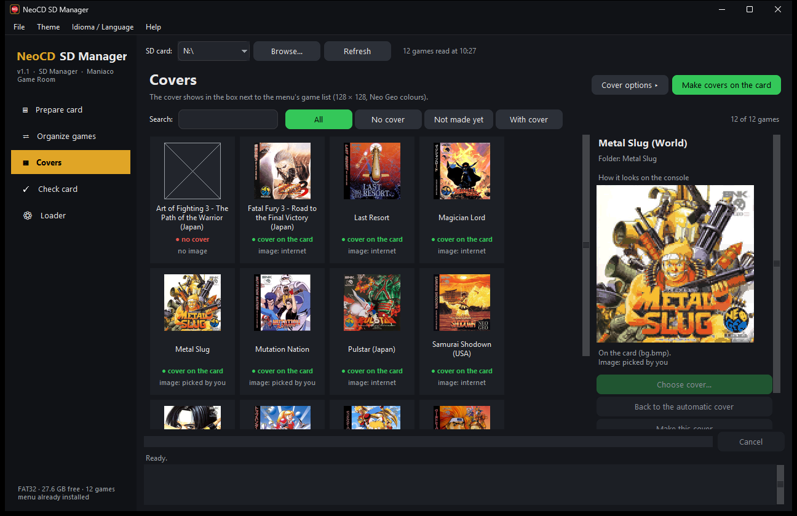
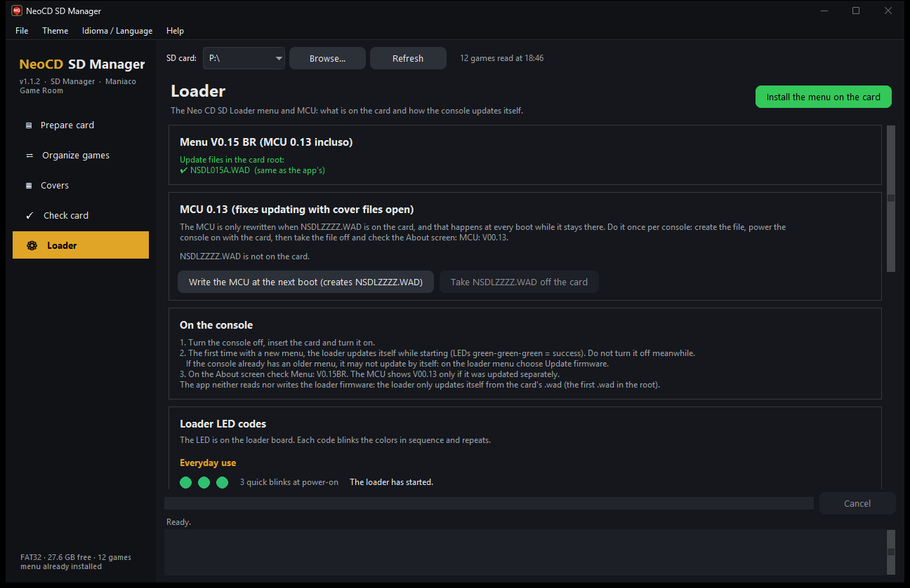
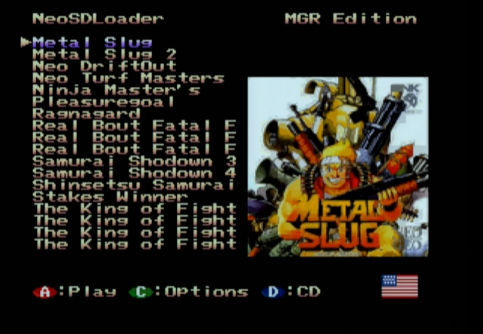
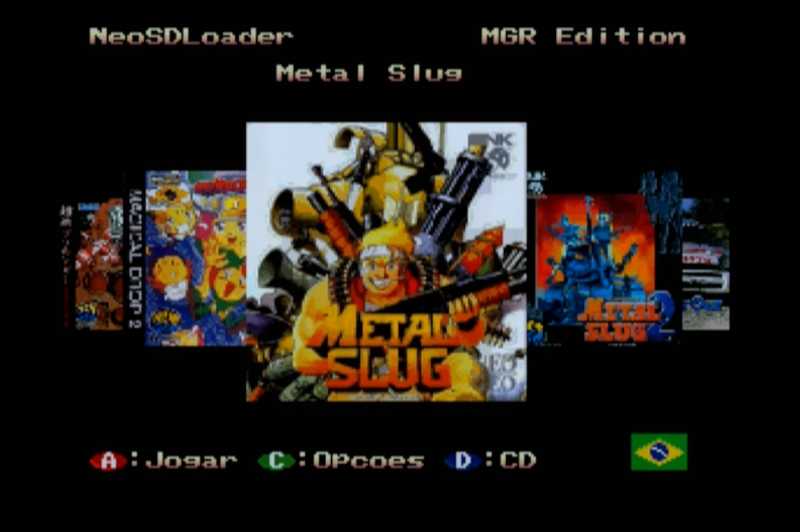
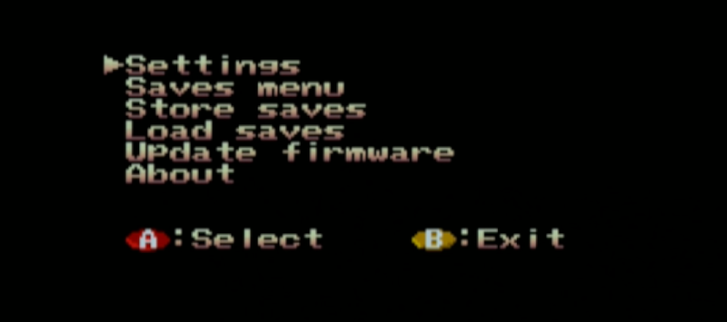
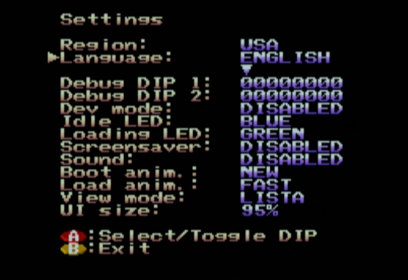
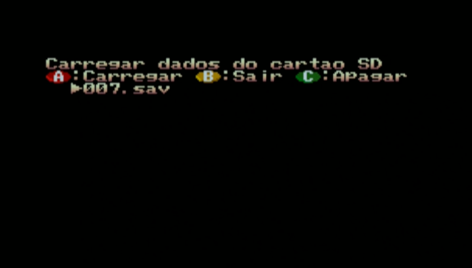
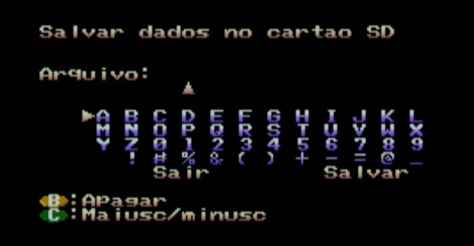

# NeoCD SD Manager — Manual

**[Versão em português](MANUAL.md)** · [How to write the firmware](FIRMWARE.en.md)

NeoCD SD Manager gets the SD card of your **Neo Geo CD with Neo CD SD Loader (BR Edition)** ready in a few clicks: it installs the menu, copies the games from the PC, organizes the names and makes a cover for each one.

A project from the **[Maniaco Game Room](https://www.maniacogameroom.com.br/)** blog. This manual covers **version 1.1.2**.

---

## Contents

1. [Before you start](#1-before-you-start)
2. [The app window](#2-the-app-window)
3. [Prepare card](#3-prepare-card)
4. [Organize games](#4-organize-games)
5. [Covers](#5-covers)
6. [Check card](#6-check-card)
7. [Loader (menu and MCU)](#7-loader-menu-and-mcu)
8. [On the console](#8-on-the-console)
9. [What goes in each folder of the card](#9-what-goes-in-each-folder-of-the-card)
10. [Troubleshooting](#10-troubleshooting)
11. [Credits](#11-credits)

---

## 1. Before you start

**You need:**

- A **Neo Geo CD** with the **Neo CD SD Loader** installed (Furrtek's kit, top-loading or front-loading version).
- A computer with **Windows 10 or 11**.
- An **SD card formatted as FAT32**. The loader does not read exFAT or NTFS; the app warns you if the card uses another format. To **update the firmware**, prefer a card of **up to 32 GB** (see [How to write the firmware](FIRMWARE.en.md)).
- The games, **each in a folder in the card root** holding the **`.cue`** file (plus the `.bin`/`.iso` and audio tracks it lists). The menu lists the folders that have a `.cue` and shows at most **200 games**. If the games are still on the PC, the app copies and converts them for you (step 2 of [Prepare card](#3-prepare-card)).
- **Internet** the first time: the app downloads the name database (Redump) and the cover lists. Then they stay on the PC, in `%LOCALAPPDATA%\NeoCD-SD-Manager`, and are downloaded again once a week (new games and covers). Offline, it uses the saved copy.

**Installation:** there is none. Download `NeoCD-SD-Manager.exe` from the [Releases](../../releases) page and open it. From 1.1 on, the app itself tells you when a new version is out (**Help → Check for updates…**).

> The first time, Windows may show "Windows protected your PC" (SmartScreen), because the program is new and has no paid signature. Click **More info → Run anyway**.

**Your card is safe:** the app **deletes nothing**. Everything it replaces (an old `.wad`, a `bg.bmp`, a fixed `.cue`) goes to `_neocd-manager/backup/<date>/`, and the old folder names can be restored. Even so, back up the card before the first time.

**What the app does not do:** it provides no games or BIOS and writes nothing straight to the console: the loader updates itself from the `.wad` file on the card.

---

## 2. The app window


- **SD card** (top): choose the card's drive letter. Removable drives are listed; if yours is missing, use **Browse…** and pick the card root.
- **Sidebar:** the five pages — *Prepare card*, *Organize games*, *Covers*, *Check card* and *Loader*. Below them is the **card status** (file system, free space, how many games, whether the menu is installed). The app reads the card once, in the background, and every page uses that reading ("N games read at HH:MM"); **Refresh** reads it again.
- Each page has a title, a short explanation and the **main action in green** in the corner. Options are folded (▸): click to open them.
- **Footer:** current step, progress and the **Cancel** button, and the **report** of what was done, with warnings.
- **File:** opens the card in Explorer. **Theme:** window colors (Night, Light, Neo Geo, CRT screen). **Idioma / Language:** Portuguese or English (the first time, Windows' language). **Help:** check for updates (and whether to check when the program opens), project page and About.

---

## 3. Prepare card

This is the main page: tick what you want and click **Prepare card**. Each step works on its own.

### Step 1 — Install the menu

Copies the update file **`NSDL015A.WAD`** (menu **V0.15 BR**, with **MCU 0.13** included) to the card root and checks the copy byte by byte (CRC32).

- The loader uses the **first `.wad`** it finds in the root. So if there is another `.wad` on the card (for example an old `NSDL014B.WAD`), the app **moves it to the backup** (it does not delete it).
- The app **writes nothing to the console**. The writing happens when you turn the console on with the card — see **[How to write the firmware](FIRMWARE.en.md)**. If the console already has an earlier BR menu (for example V0.14BR), do not count on an automatic update: use **Update firmware** in **Options**, on the loader menu.

**"Also write the new MCU to the console" option** (off by default). The MCU is the loader's microcontroller; version 0.13, which comes with `NSDL015A.WAD`, fixes **updating with covers**; 0.12 fixed the **game list order**. It is only rewritten when a **`NSDLZZZZ.WAD`** is on the card, and the app creates that file if you tick the option. Do it once per console and then take the file off (details in the [firmware tutorial](FIRMWARE.en.md)). If you already have `MCU: V00.13` you do not need it.

### Step 2 — Copy games from a PC folder

Choose the PC folder with the games (**Choose the folder…**). The app lists each game and says whether it is **already** on the card (by folder name or by Redump name), its size and the free space left. Tick the ones to send (**Only the missing ones**, **All**, **None**) and confirm.

Accepted formats and what happens to each one:

| On the PC | On the card |
|---|---|
| `.cue` + `.bin`/`.iso`/`.wav` | copied as it is |
| `.cue` with non-standard WAVE audio, `.nrg`, `.toc` | converted with chdman (audio becomes BINARY) |
| `.chd` | extracted with chdman: one `.bin` per track, as in Redump |
| `.ccd` + `.img` | `.cue` written from the `.ccd` (`.img` becomes `.bin`) |
| a lone `.iso` or `.bin` | `.cue` created (data track only) |
| `.zip` holding one of these | extracted straight to the card |

Not copied (the app tells you why): MP3/OGG/FLAC/APE audio, `.7z`, `.rar`, `.ecm`, `.mds/.mdf`, `.cdi` and discs whose track 1 is not MODE1. Each game is copied under a temporary name and only gets its final name at the end: an interrupted copy leaves no half game. Above 200 games the app warns you (the menu does not show them all).

### Step 3 — Organize the game names

Renames each game folder with the right title (see [Organize games](#4-organize-games)). In **How to name the games**:

- **Style:** *Short title* (default: western title, no tags and no subtitle — `Garou Densetsu 2 ~ Fatal Fury 2 (Japan) (En,Ja)` → `Fatal Fury 2`) or *Full official name* (the Redump database name). If two folders would get the same name, the region is added.
- **Check by disc content (CRC):** compares the data track with the database. Slower (it reads each game's whole file) and safer; it only works with Redump-standard dumps.

Names are written in **plain ASCII** (the loader uses code page 850). Only the **folder** is renamed: the files inside are not touched. A folder never overwrites another.

### Step 4 — Make the covers

Creates a **`bg.bmp`** in each game folder — the cover the menu shows next to the list. In **Cover options**:

- **Image fit:** *Stretch* (default), *Fill* (crops the edges), *Whole image on a blurred backdrop* or *Whole image with black borders*. It only matters for images that are not square (title screen, flyer, your own image).
- **Redo the ones that already exist:** by default, games that already have a `bg.bmp` are skipped. When ticked, the old one goes to the backup and is made again — use it to apply **version 1.1's new color conversion** to covers you already had.
- **My images (optional):** a folder with `.png`, `.jpg`, `.webp` or `.bmp` named **like the game** (e.g. `Fatal Fury 2.png`). It takes priority over the internet.
- **Menu general cover (bg.bmp in the root):** shown when the menu opens and behind the games that have no cover of their own. **Choose image…**, **Paste image (Ctrl+V)** or **Take off the card** (it goes to the backup).

Where the cover comes from, in order: the image you chose for the game ([Covers](#5-covers) page), the *My images* folder, the Neo Geo CD box from libretro-thumbnails and, when there is none, the TheGamesDB cover, the cartridge (AES) box or the arcade flyer.

The format is the menu's: **128 × 128**, 4 bits per pixel, up to **32 palettes of 15 colors** (one per 16 × 16 pixel block), 5 bits per color channel. Version 1.1's conversion picks the palettes per block more faithfully (checked on the console with Metal Slug and Mutation Nation), and 1.1.2 went from 8 to 32 palettes. Covers with 32 palettes need the **V0.15BR** menu; older covers are still accepted. Check the result in the preview of the [Covers](#5-covers) page.

At the end you get a summary: games copied, folders renamed, covers made, games without a cover, unidentified games and warnings.

---

## 4. Organize games


Shows each game with the **current folder**, the **new name** and **how it was identified** (name, approximate name, content/CRC or not identified), before anything changes:

- **Apply names:** renames the folders (asks first). The record is kept in `_neocd-manager/desfazer.json`.
- **Undo last:** gives the folders of the last batch their previous names back.
- **Edit name…** (or double-click a game): type any name you want; it is applied with *Apply names*. Names over **25 characters** are cut by the menu (it shows 18 at a time and scrolls the rest), and the app warns you.
- **Do not change / organize again:** a marked game is never renamed (also by *Prepare card*). A name edited by hand becomes "do not change" automatically.

An **approximate** name (with `?`, in red) is a suggestion: the folder title did not exactly match the database, and the game is **not renamed by itself**. If it is right, **double-click** to accept it and use *Apply names*.

---

## 5. Covers



A grid with each game's cover and the mark **cover on the card**, **not made yet** or **no cover**. Use **Search** and the filters (*With cover*, *Not made yet*, *No cover*). Click a game and the side panel shows **how it looks on the console** — the preview already with the reduced colors and palettes, read from the card's own `bg.bmp`.

- **Choose cover…** (or double-click the game): opens a window that already searches every source — your folder, libretro Neo Geo CD (box, title, snapshot, logo), TheGamesDB, libretro's cartridge version and the Arcade Database. Click an image and it becomes the cover. In the **Game** field you can change the name and click **Search again**; you can also **Paste (Ctrl+V)** or use **Image from the PC…**. If nothing fits, **Not found? Search in the browser ▾** opens Google, Bing, LaunchBox, MobyGames and others.
- **Back to the automatic cover:** undoes the choice.
- **Make this cover:** remakes only that game's `bg.bmp`.
- **Make covers on the card** (green button): makes the missing ones, with the [cover options](#step-4--make-the-covers).

The choice is kept on the card (`_neocd-manager/capas/`) and follows the game if the folder is renamed. Each change rewrites the `bg.bmp` at once; the previous one goes to the backup.

---

## 6. Check card

Looks for what the loader cannot read and says what to do in each case (**Folder**, **Problem**, **What to do**). **Fix what can be fixed** only fixes the safe cases by itself, always keeping a copy of the original `.cue` in the backup:

- `.cue` with extra dots in its name (the loader reads the extension from the first dot);
- a file name without quotes, or a TAB at the start of a `.cue` line;
- a `.cue` listing a file that does not exist, when a single file of the same type is left;
- a folder with a single `.iso` or `.bin` and no `.cue` (the `.cue` is created).

The rest is only reported: a file without an extension (it hides the game), track 1 that is not MODE1, MP3/OGG/FLAC audio, several `.cue` in the same folder, compressed files.

---

## 7. Loader (menu and MCU)



- Shows the `.wad` files in the card root and whether they match the app's; **Install the menu on the card** does the same as step 1 of *Prepare card*.
- **Write the MCU at the next boot (creates NSDLZZZZ.WAD)** and **Take NSDLZZZZ.WAD off the card**.
- **On the console:** the writing steps.
- **Loader LED codes:** the full table, with what each color sequence means.

The full tutorial, with pictures of the screens, is in **[How to write the firmware](FIRMWARE.en.md)**.

---

## 8. On the console

1. Turn the console off, insert the card into the SD Loader and turn it on.
2. If the menu needs to be written, the loader does it by itself while starting (the LED blinks blue; do not turn it off). **If the console already has an earlier BR menu** (e.g. `NSDL014B` or `NSDL014D`), do not count on an automatic update: press **C** (Options) on the loader menu and choose **Update firmware**. Steps in [How to write the firmware](FIRMWARE.en.md).
3. In the game list, the titles show the organized names. When the cursor rests on a game, its **cover** appears in the box next to the list.
4. New in the `NSDL015A` menu (V0.15BR): besides the list, the menu has a five-cover **carousel**, with the center cover highlighted and the title above it (**View mode** option in **Settings**); **UI size** from 80% to 100% (left decreases, right increases); the flag follows the menu language (the region is not changed); the SD card **load** and **save** screens were fixed. Still there: the **Language** row in **Settings** (PT-BR, the default, or English), the cover that hides while the options menu is open, the cursor that stays on the same game when you go back with **B**, and long names scrolling in a loop.





The **About** screen shows `Menu: V0.15BR`; the MCU shows as `V00.13` if you already wrote MCU 0.13 (otherwise it shows the earlier version):

| | |
|---|---|
|  |  |
|  |  |
|  | |

---

## 9. What goes in each folder of the card

```
/                         card root (FAT32)
├─ NSDL015A.WAD           menu V0.15 BR (includes MCU 0.13)
├─ NSDLZZZZ.WAD           (only if you asked to "write the MCU"; take it off after the 1st boot)
├─ bg.bmp                 (optional) menu general cover
├─ ROMDUMP.BIN            created by the loader when writing the menu: YOUR console's BIOS (do not share it)
├─ Fatal Fury 2/          one folder per game
│   ├─ jogo.cue           the menu lists the folders that have a .cue
│   ├─ jogo.bin           (disc files)
│   └─ bg.bmp             cover made by the app
└─ _neocd-manager/        created by the app
    ├─ desfazer.json      record of the renamed folders (for "Undo last")
    ├─ nao_alterar.json   games marked "do not change"
    ├─ capas/             covers chosen per game
    └─ backup/<date>/     .wad, bg.bmp and .cue files that were replaced
```

The app keeps its settings and the database/cover cache in `%LOCALAPPDATA%\NeoCD-SD-Manager`.

---

## 10. Troubleshooting

**"The card is NTFS/exFAT — must be FAT32".** The loader only reads FAT32. Copy the files to the PC, format the card as FAT32 (for large cards use a FAT32 formatting tool) and copy them back.

**A game is "not identified".** The folder name matches no game in the database (homebrew, hack or a very different name). Use **Edit name…**, or tick **Check by disc content (CRC)**. It can still get a cover through the **Choose cover…** window: a name that is not in the database is looked up by title in libretro and in the cartridge version (for example, a CD conversion of a cartridge game).

**A game has "no cover".** Open **Choose cover…** on the *Covers* page: besides libretro, it searches TheGamesDB, the cartridge version and the Arcade Database. If nothing fits, paste or choose an image from the PC.

**The cover looks bad or has odd colors.** The menu shows only 15 colors per 16 × 16 pixel block; very dark covers or gradients suffer. Choose another image, try another *Image fit* or use **Redo the ones that already exist** to apply version 1.1's conversion.

**The game does not show in the menu.** Run **Check card**. Also check that the folder is in the root, has a `.cue` and that the card has no more than 200 games.

**The console did not update the menu.** There must be **a single `.wad`** in the root. If the console already had a BR menu, use **Update firmware** on the loader menu. If it falls back to the console's original screen, switch to a card of up to 32 GB. Everything is in [How to write the firmware](FIRMWARE.en.md#5-if-something-goes-wrong).

**Windows blocked the program / the antivirus complained.** The `.exe` is new and has no paid signature; programs packaged like this sometimes raise false alarms. Check the `.exe` against the SHA-256 published on the release page.

**Found another problem?** Open an [Issue](../../issues) with the report text.

---

## 11. Credits

- **Neo CD SD Loader** (original hardware, firmware and menu): Furrtek — [furrtek.org/sdloader](http://www.furrtek.org/sdloader/)
- **BR Edition** (Portuguese/English menu, covers, dynamic background): Maniaco Game Room — [NeoCD SD Manager](https://github.com/maniaco007/NeoCD-SD-Manager)
- Covers: [libretro-thumbnails](https://github.com/libretro-thumbnails), [TheGamesDB](https://thegamesdb.net/) (through [Hasheous](https://hasheous.org/)) and [Arcade Database](http://adb.arcadeitalia.net/) · Game databases (Redump): [libretro-database](https://github.com/libretro/libretro-database)
- `.exe` components: Python, Tcl/Tk, Pillow, NumPy, Nuitka and MAME's chdman (licenses in [TERCEIROS.md](TERCEIROS.md))
