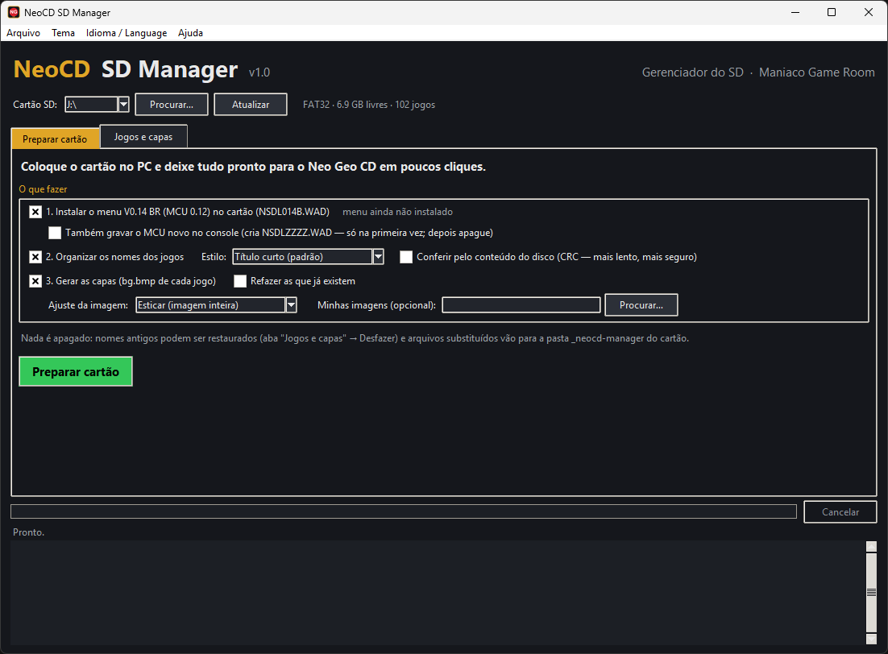
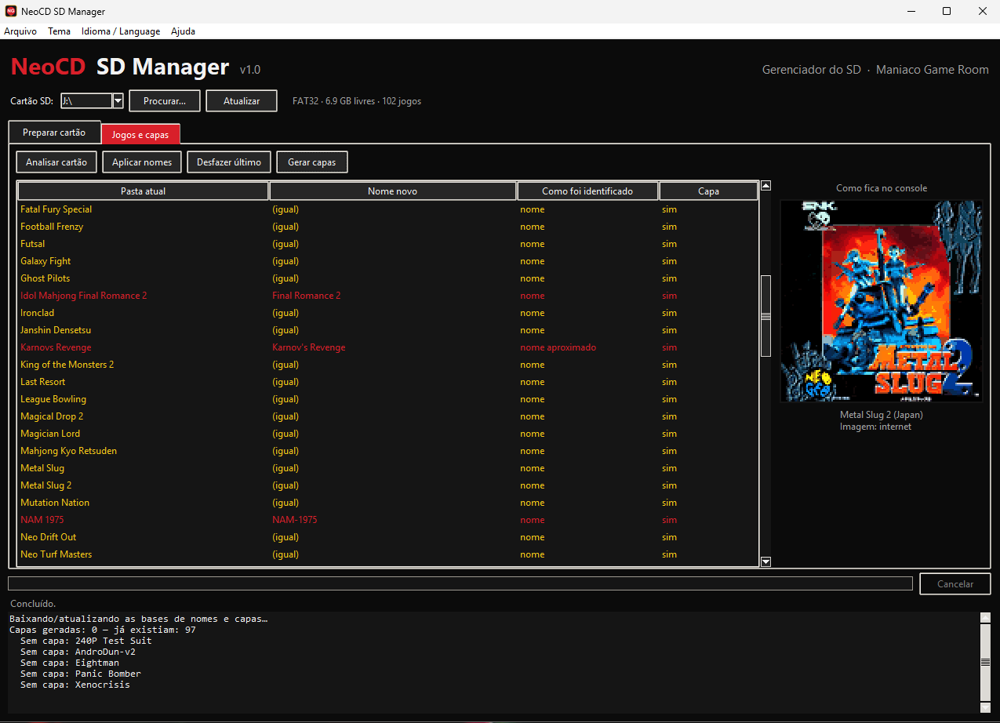
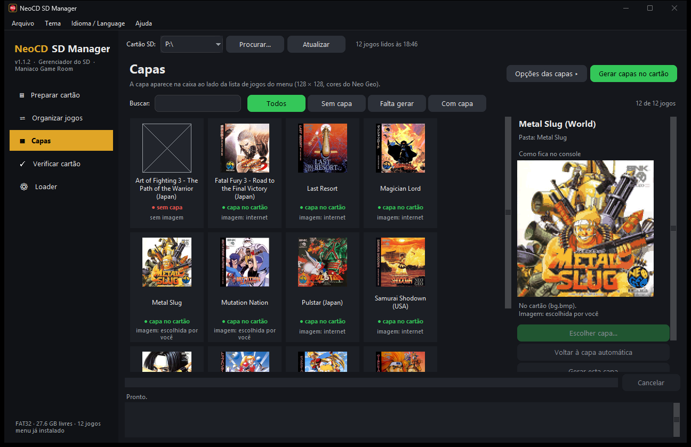
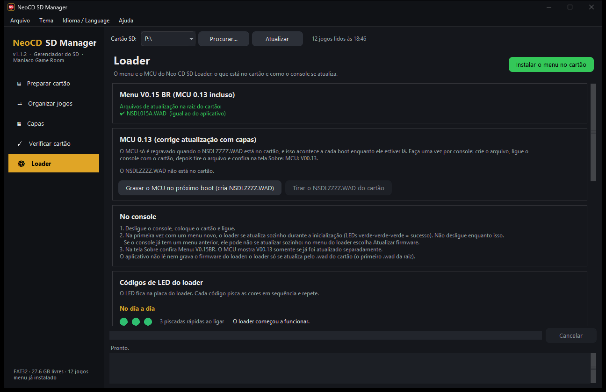
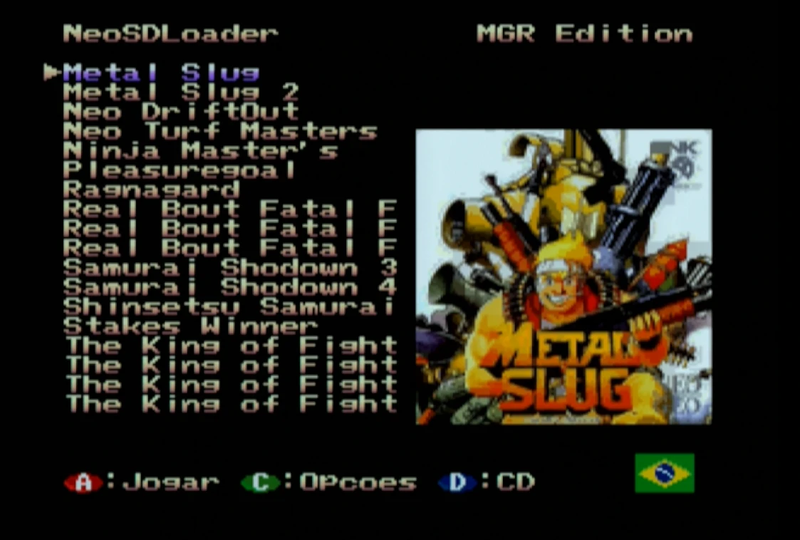
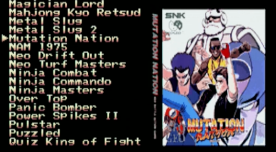
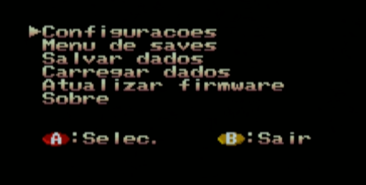
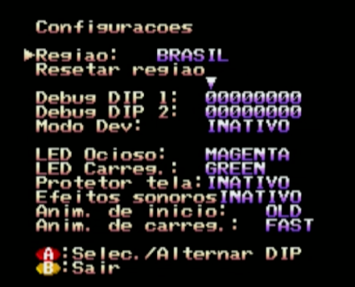
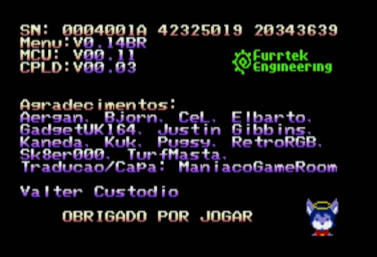

# Manual do NeoCD SD Manager

**[English version](MANUAL.en.md)** · [Como gravar o firmware](FIRMWARE.md)

O NeoCD SD Manager deixa o cartão SD do seu **Neo Geo CD com Neo CD SD Loader (BR Edition)** pronto em poucos cliques: instala o menu, copia os jogos do PC, organiza os nomes e gera a capa de cada um.

Um projeto do blog **[Maniaco Game Room](https://www.maniacogameroom.com.br/)**. Este manual é da **versão 1.1**.

---

## Sumário

1. [Antes de começar](#1-antes-de-começar)
2. [A janela do aplicativo](#2-a-janela-do-aplicativo)
3. [Preparar cartão](#3-preparar-cartão)
4. [Organizar jogos](#4-organizar-jogos)
5. [Capas](#5-capas)
6. [Verificar cartão](#6-verificar-cartão)
7. [Loader (menu e MCU)](#7-loader-menu-e-mcu)
8. [No console](#8-no-console)
9. [O que fica em cada pasta do cartão](#9-o-que-fica-em-cada-pasta-do-cartão)
10. [Problemas e soluções](#10-problemas-e-soluções)
11. [Créditos](#11-créditos)

---

## 1. Antes de começar

**Você precisa de:**

- Um **Neo Geo CD** com o **Neo CD SD Loader** instalado (o kit de Furrtek, versão top-loading ou front-loading).
- Um computador com **Windows 10 ou 11**.
- Um **cartão SD formatado em FAT32**. O loader não lê exFAT nem NTFS; o aplicativo avisa se o cartão estiver em outro formato. Para **atualizar o firmware**, prefira um cartão de **até 32 GB** (veja [Como gravar o firmware](FIRMWARE.md)).
- Os jogos, **cada um em uma pasta na raiz** do cartão com o arquivo **`.cue`** (mais os `.bin`/`.iso` e as faixas de áudio que ele cita). O menu lista as pastas que têm um `.cue` e mostra no máximo **200 jogos**. Se os jogos ainda estão no PC, o aplicativo copia e converte para você (passo 2 do [Preparar cartão](#3-preparar-cartão)).
- **Internet** na primeira vez: o aplicativo baixa o banco de nomes (Redump) e as listas de capas. Depois ficam guardados no PC, em `%LOCALAPPDATA%\NeoCD-SD-Manager`, e são baixados de novo uma vez por semana (jogos e capas novos). Sem internet, ele usa a cópia guardada.

**Instalação:** não há instalação. Baixe o `NeoCD-SD-Manager.exe` na página de [Releases](../../releases) e abra. A partir da 1.1, o próprio aplicativo avisa quando sai uma versão nova (**Ajuda → Verificar atualizações…**).

> Na primeira vez, o Windows pode mostrar "O Windows protegeu o computador" (SmartScreen), porque o programa é novo e não tem assinatura paga. Clique em **Mais informações → Executar assim mesmo**.

**Seu cartão está seguro:** o aplicativo **não apaga nada**. Tudo o que for substituído (um `.wad` antigo, um `bg.bmp`, um `.cue` corrigido) vai para `_neocd-manager/backup/<data>/`, e os nomes antigos das pastas podem ser restaurados. Mesmo assim, faça uma cópia do cartão antes da primeira vez.

**O que o aplicativo não faz:** não fornece jogos nem BIOS e não grava nada direto no console: o loader se atualiza sozinho pelo arquivo `.wad` do cartão.

---

## 2. A janela do aplicativo



- **Cartão SD** (topo): escolha a letra do cartão. Aparecem os discos removíveis; se o seu não aparecer, use **Procurar…** e escolha a raiz do cartão.
- **Barra lateral:** as cinco telas — *Preparar cartão*, *Organizar jogos*, *Capas*, *Verificar cartão* e *Loader*. Embaixo dela fica a **situação do cartão** (sistema de arquivos, espaço livre, quantos jogos, se o menu está instalado). O aplicativo lê o cartão uma vez, em segundo plano, e todas as telas usam essa leitura ("N jogos lidos às HH:MM"); **Atualizar** lê de novo.
- Cada tela tem o título, uma explicação curta e a **ação principal em verde** no canto. As opções ficam recolhidas (▸): clique para abrir.
- **Rodapé:** etapa atual, andamento e o botão **Cancelar**, e o **relatório** do que foi feito, com os avisos.
- **Arquivo:** abre o cartão no Explorer. **Tema:** cores da janela (Noite, Claro, Neo Geo, Tela CRT). **Idioma / Language:** português ou inglês (na primeira vez, o idioma do Windows). **Ajuda:** verificar atualizações (e se verifica ao abrir), página do projeto e Sobre.

---

## 3. Preparar cartão

É a tela principal: marque o que quer fazer e clique em **Preparar cartão**. Cada passo funciona sozinho.

### Passo 1 — Instalar o menu

Copia o arquivo de atualização **`NSDL014D.WAD`** (menu **V0.14 BR**, MCU **0.12**) para a raiz do cartão e confere a cópia byte a byte (CRC32).

- O loader usa o **primeiro `.wad`** que achar na raiz. Por isso, se houver outro `.wad` no cartão (por exemplo, um `NSDL014B.WAD` antigo), o aplicativo o **move para o backup** (não apaga).
- O aplicativo **não grava nada no console**. A gravação acontece quando você liga o console com o cartão — veja **[Como gravar o firmware](FIRMWARE.md)**. Quem já tem um menu V0.14BR anterior precisa usar **Atualizar firmware** no menu do loader.

**Opção "Também gravar o MCU novo no console"** (desligada por padrão). O MCU é o microcontrolador do loader; a versão 0.12 corrige a **ordenação da lista de jogos**. Ele só é regravado quando existe um **`NSDLZZZZ.WAD`** no cartão, e o aplicativo cria esse arquivo se você marcar a opção. Faça uma vez por console e depois tire o arquivo (detalhes no [tutorial do firmware](FIRMWARE.md)). Quem já está com `MCU: V00.12` não precisa marcar.

### Passo 2 — Copiar jogos de uma pasta do PC

Escolha a pasta do PC com os jogos (**Escolher a pasta…**). O aplicativo lista cada jogo e diz se ele **já está** no cartão (pelo nome da pasta ou pelo nome Redump), quanto ocupa e quanto sobra livre. Marque os que quer enviar (**Só os que faltam**, **Todos**, **Nenhum**) e confirme.

Formatos aceitos e o que acontece com cada um:

| No PC | No cartão |
|---|---|
| `.cue` + `.bin`/`.iso`/`.wav` | copiado como está |
| `.cue` com áudio WAVE fora do padrão, `.nrg`, `.toc` | convertido pelo chdman (áudio vira BINARY) |
| `.chd` | extraído pelo chdman: um `.bin` por faixa, como no Redump |
| `.ccd` + `.img` | `.cue` escrito a partir do `.ccd` (`.img` vira `.bin`) |
| `.iso` ou `.bin` sozinho | `.cue` criado (só a faixa de dados) |
| `.zip` com um desses | descompactado direto no cartão |

Não são copiados (o aplicativo diz o motivo): áudio MP3/OGG/FLAC/APE, `.7z`, `.rar`, `.ecm`, `.mds/.mdf`, `.cdi` e discos cuja faixa 1 não é MODE1. Cada jogo é copiado com um nome temporário e só ganha o nome final no fim: uma cópia interrompida não deixa jogo pela metade. Acima de 200 jogos o aplicativo avisa (o menu não mostra todos).

### Passo 3 — Organizar os nomes dos jogos

Renomeia a pasta de cada jogo com o título certo (veja [Organizar jogos](#4-organizar-jogos)). Em **Como organizar os nomes**:

- **Estilo:** *Título curto* (padrão: título ocidental, sem etiquetas e sem subtítulo — `Garou Densetsu 2 ~ Fatal Fury 2 (Japan) (En,Ja)` → `Fatal Fury 2`) ou *Nome oficial completo* (o nome do banco Redump). Se duas pastas dariam o mesmo nome, entra a região.
- **Conferir pelo conteúdo do disco (CRC):** compara a faixa de dados com o banco. Mais lento (lê o arquivo inteiro de cada jogo) e mais seguro; só funciona com dumps no padrão Redump.

Os nomes são gravados em **ASCII simples** (o loader usa a página de código 850). Só a **pasta** é renomeada: os arquivos dentro dela não são tocados. Uma pasta nunca sobrescreve outra.

### Passo 4 — Gerar as capas

Cria um **`bg.bmp`** na pasta de cada jogo — é a capa que o menu mostra ao lado da lista. Em **Opções das capas**:

- **Ajuste da imagem:** *Esticar* (padrão), *Preencher* (corta as bordas), *Inteira com fundo desfocado* ou *Inteira com bordas pretas*. Só faz diferença em imagem que não é quadrada (tela de título, flyer, imagem sua).
- **Refazer as que já existem:** por padrão, quem já tem `bg.bmp` é pulado. Marcando, o antigo vai para o backup e é refeito — use para aplicar a **conversão de cores nova da 1.1** às capas que você já tinha.
- **Minhas imagens (opcional):** pasta com `.png`, `.jpg`, `.webp` ou `.bmp` com o **mesmo nome do jogo** (ex.: `Fatal Fury 2.png`). Tem prioridade sobre a internet.
- **Capa geral do menu (bg.bmp na raiz):** aparece quando o menu abre e atrás dos jogos que não têm capa própria. **Escolher imagem…**, **Colar imagem (Ctrl+V)** ou **Tirar do cartão** (vai para o backup).

De onde vem a capa, em ordem: a imagem que você escolheu para o jogo (tela [Capas](#5-capas)), a pasta *Minhas imagens*, a caixa do Neo Geo CD do libretro-thumbnails e, quando ela não existe, a capa do TheGamesDB, a caixa da versão cartucho (AES) ou o flyer do arcade.

O formato é o do menu: **128 × 128**, 4 bits por pixel, até **8 paletas de 15 cores**, cores em 5 bits por canal. A conversão da 1.1 escolhe as paletas por bloco de 16 × 16 pixels de forma mais fiel (foi conferida no console com Metal Slug e Mutation Nation). Confira o resultado na prévia da tela [Capas](#5-capas).

Ao final aparece o resumo: jogos copiados, pastas renomeadas, capas geradas, jogos sem capa, não identificados e avisos.

---

## 4. Organizar jogos



Mostra cada jogo com a **pasta atual**, o **nome novo** e **como foi identificado** (nome, nome aproximado, conteúdo/CRC ou não identificado), antes de mexer:

- **Aplicar nomes:** renomeia as pastas (com confirmação). O registro fica em `_neocd-manager/desfazer.json`.
- **Desfazer último:** volta as pastas do último lote ao nome anterior.
- **Editar nome…** (ou dois cliques num jogo): escreva o nome que quiser; ele é aplicado com *Aplicar nomes*. Nomes acima de **25 caracteres** são cortados pelo menu (que mostra 18 por vez e rola o resto), e o aplicativo avisa.
- **Não alterar / voltar a organizar:** o jogo marcado nunca é renomeado (vale também para o *Preparar cartão*). Um nome editado à mão vira "não alterar" automaticamente.

Um nome **aproximado** (com `?`, em vermelho) é uma sugestão: o título da pasta não bateu exatamente com o banco, e o jogo **não é renomeado sozinho**. Se estiver certo, dê **dois cliques** para aceitar e use *Aplicar nomes*.

---

## 5. Capas



Uma grade com a capa de cada jogo e a marca **capa no cartão**, **falta gerar** ou **sem capa**. Use **Buscar** e os filtros (*Com capa*, *Falta gerar*, *Sem capa*). Ao clicar num jogo, o painel ao lado mostra **como fica no console** — a prévia já com as cores e as paletas reduzidas, lida do próprio `bg.bmp` do cartão.

- **Escolher capa…** (ou dois cliques no jogo): abre uma janela que já procura imagens em todas as fontes — a sua pasta, o libretro Neo Geo CD (caixa, título, captura, logo), o TheGamesDB, o libretro da versão cartucho e a Arcade Database. Clique numa imagem e ela vira a capa. No campo **Jogo** você pode trocar o nome e clicar em **Procurar de novo**; também dá para **Colar (Ctrl+V)** ou usar **Imagem do PC…**. Se nada servir, **Procurar no navegador ▾** abre Google, Bing, LaunchBox, MobyGames e outros.
- **Voltar à capa automática:** desfaz a escolha.
- **Gerar esta capa:** refaz só o `bg.bmp` desse jogo.
- **Gerar capas no cartão** (botão verde): gera as que faltam, com as [opções das capas](#passo-4--gerar-as-capas).

A escolha fica guardada no cartão (`_neocd-manager/capas/`) e acompanha o jogo se a pasta for renomeada. Cada mudança já regrava o `bg.bmp`; o anterior vai para o backup.

---

## 6. Verificar cartão

Procura o que o loader não consegue ler e diz o que fazer em cada caso (**Pasta**, **Problema**, **O que fazer**). **Corrigir o que der** conserta sozinho só o que é seguro, sempre com cópia do `.cue` original no backup:

- `.cue` com pontos a mais no nome (o loader lê a extensão a partir do primeiro ponto);
- nome de arquivo sem aspas ou TAB no começo da linha do `.cue`;
- `.cue` que cita um arquivo que não existe, quando sobra um único arquivo do mesmo tipo;
- pasta com um único `.iso` ou `.bin` e nenhum `.cue` (cria o `.cue`).

O resto só é avisado: arquivo sem extensão (esconde o jogo), faixa 1 que não é MODE1, áudio MP3/OGG/FLAC, vários `.cue` na mesma pasta, arquivos compactados.

---

## 7. Loader (menu e MCU)



- Mostra os `.wad` da raiz do cartão e se são iguais ao do aplicativo; **Instalar o menu no cartão** faz o mesmo que o passo 1 do *Preparar cartão*.
- **Gravar o MCU no próximo boot (cria NSDLZZZZ.WAD)** e **Tirar o NSDLZZZZ.WAD do cartão**.
- **No console:** o passo a passo da gravação.
- **Códigos de LED do loader:** a tabela completa, com o que cada sequência de cores significa.

O tutorial completo, com fotos das telas, está em **[Como gravar o firmware](FIRMWARE.md)**.

---

## 8. No console

1. Desligue o console, coloque o cartão no SD Loader e ligue.
2. Se o menu precisar ser gravado, o loader faz isso sozinho na inicialização (o LED pisca em azul; não desligue). **Se o console já tem um V0.14BR anterior** (ex.: `NSDL014B`), ele **não** se atualiza sozinho: no menu do loader escolha **Atualizar firmware**. Passo a passo em [Como gravar o firmware](FIRMWARE.md).
3. Na lista de jogos, os títulos aparecem com os nomes organizados. Ao parar o cursor sobre um jogo, a **capa** aparece na caixa ao lado da lista.
4. Novidades do menu `NSDL014D`: em **Configurações** há a linha **Idioma** (PT-BR, padrão, ou English); a capa some enquanto o menu de opções está aberto; ao voltar com **B**, o cursor continua no mesmo jogo; nomes longos rolam em loop.





A tela **Sobre** mostra `Menu: V0.14BR` e `MCU: V00.12`:

| | |
|---|---|
|  |  |
|  | |

---

## 9. O que fica em cada pasta do cartão

```
/                         raiz do cartão (FAT32)
├─ NSDL014D.WAD           menu V0.14 BR + MCU 0.12
├─ NSDLZZZZ.WAD           (só se você pediu "gravar o MCU"; tire depois do 1º boot)
├─ bg.bmp                 (opcional) capa geral do menu
├─ ROMDUMP.BIN            criado pelo loader ao gravar o menu: a BIOS do SEU console (não distribua)
├─ Fatal Fury 2/          uma pasta por jogo
│   ├─ jogo.cue           o menu lista as pastas que têm um .cue
│   ├─ jogo.bin           (arquivos do disco)
│   └─ bg.bmp             capa gerada pelo aplicativo
└─ _neocd-manager/        criada pelo aplicativo
    ├─ desfazer.json      registro dos renomeados (para "Desfazer último")
    ├─ nao_alterar.json   jogos marcados como "não alterar"
    ├─ capas/             capas escolhidas por jogo
    └─ backup/<data>/     .wad, bg.bmp e .cue que foram substituídos
```

O aplicativo guarda configurações e o cache de bancos/capas em `%LOCALAPPDATA%\NeoCD-SD-Manager`.

---

## 10. Problemas e soluções

**"O cartão está em NTFS/exFAT — precisa ser FAT32".** O loader só lê FAT32. Copie os arquivos para o PC, formate o cartão em FAT32 (em cartões grandes, use uma ferramenta de formatação FAT32) e copie de volta.

**Um jogo ficou "não identificado".** O nome da pasta não bate com nenhum jogo do banco (homebrew, hack ou nome muito diferente). Use **Editar nome…**, ou marque **Conferir pelo conteúdo (CRC)**. Ele ainda pode ganhar capa pela janela **Escolher capa…**: um nome que não está no banco é procurado pelo título no libretro e na versão cartucho (por exemplo, a conversão em CD de um jogo de cartucho).

**Um jogo ficou "sem capa".** Abra **Escolher capa…** na tela *Capas*: além do libretro, ela procura no TheGamesDB, na versão cartucho e na Arcade Database. Se nada servir, cole ou escolha uma imagem do PC.

**A capa ficou feia ou com cores estranhas.** O menu só exibe 15 cores por bloco de 16 × 16 pixels; capas muito escuras ou com degradês sofrem. Escolha outra imagem, teste outro *Ajuste da imagem* ou use **Refazer as que já existem** para aplicar a conversão da 1.1.

**O jogo não aparece no menu.** Rode **Verificar cartão**. Confira também se a pasta está na raiz, tem um `.cue` e se o cartão não passa de 200 jogos.

**O console não atualizou o menu.** Deve haver **um só `.wad`** na raiz. Se o console já tinha um V0.14BR, use **Atualizar firmware** no menu do loader. Se voltar para a tela original do console, troque por um cartão de até 32 GB. Tudo em [Como gravar o firmware](FIRMWARE.md#5-se-algo-der-errado).

**O Windows bloqueou o programa / o antivírus reclamou.** O `.exe` é novo e sem assinatura paga; programas empacotados assim às vezes geram alerta falso. Confira o `.exe` pelo SHA-256 publicado na página da versão.

**Encontrou outro problema?** Abra uma [Issue](../../issues) informando o texto do relatório.

---

## 11. Créditos

- **Neo CD SD Loader** (hardware, firmware e menu originais): Furrtek — [furrtek.org/sdloader](http://www.furrtek.org/sdloader/)
- **BR Edition** (menu em português/inglês, capas, fundo dinâmico): Maniaco Game Room — [NeoCD SD Manager](https://github.com/maniaco007/NeoCD-SD-Manager)
- Capas: [libretro-thumbnails](https://github.com/libretro-thumbnails), [TheGamesDB](https://thegamesdb.net/) (via [Hasheous](https://hasheous.org/)) e [Arcade Database](http://adb.arcadeitalia.net/) · Bancos de jogos (Redump): [libretro-database](https://github.com/libretro/libretro-database)
- Componentes do `.exe`: Python, Tcl/Tk, Pillow, NumPy, Nuitka e o chdman do MAME (licenças em [TERCEIROS.md](TERCEIROS.md))
