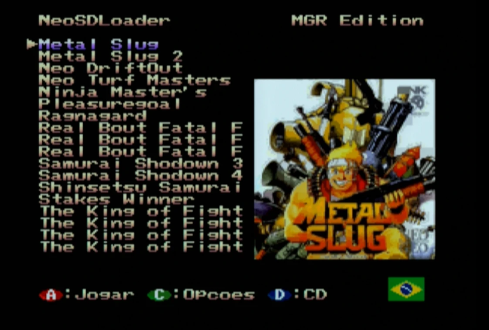
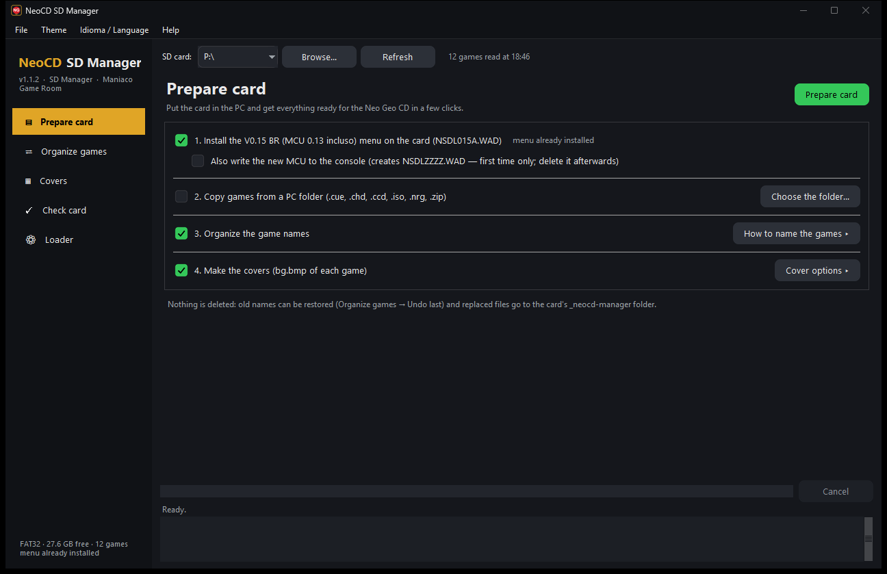
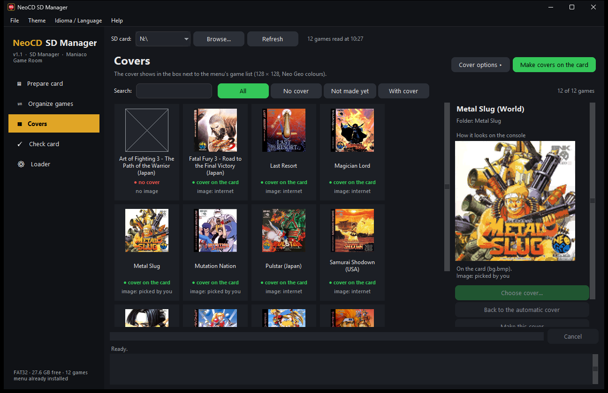
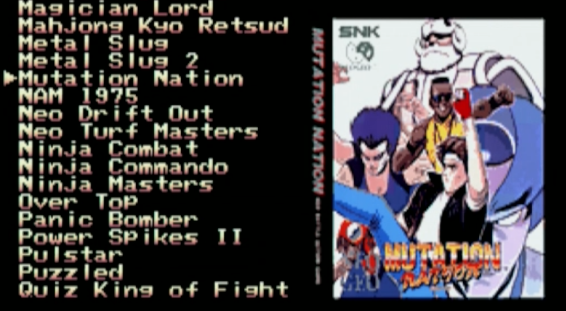
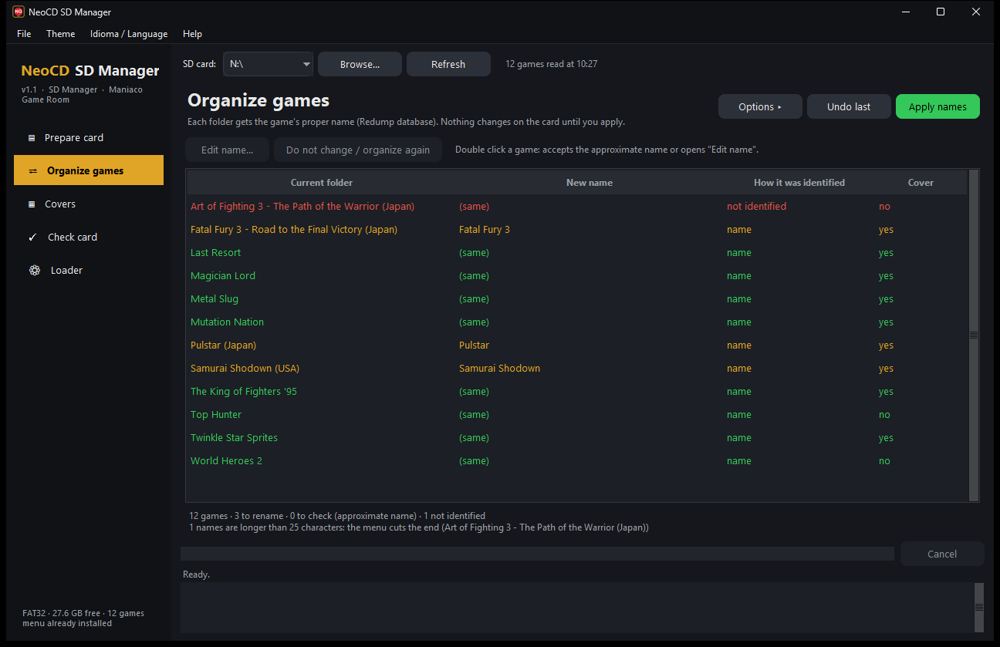
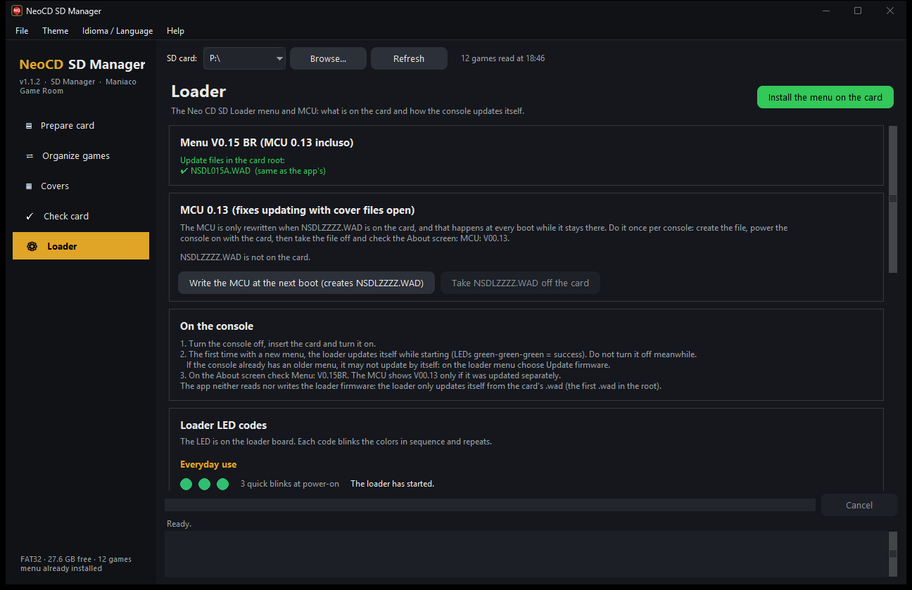
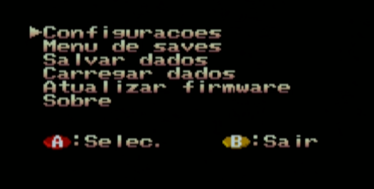
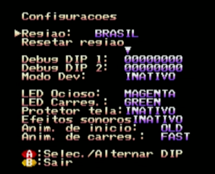

# NeoCD SD Manager

**[Português](README.md)**

**Windows app that gets the SD card of your Neo Geo CD (Neo CD SD Loader — BR Edition) ready in a few clicks: it installs the menu, copies the games from the PC, gives every game its proper name and makes the cover of each one.**

A project of the **[Maniaco Game Room](https://www.maniacogameroom.com.br/)** blog.

## How it works

Put the SD card in the PC, open the app and click **Prepare card**. It:

1. **installs the BR Edition menu** on the card (copies the update file `NSDL014D.WAD` and verifies the copy);
2. **copies games from a PC folder**, converting `.chd`, `.ccd`, `.nrg`, `.iso` and `.zip` into the format the loader reads;
3. **organizes the game names:** identifies each folder by name (and, if you want, by disc content, against the Redump database) and renames it with the proper title, e.g. `metal_slug_2 [!]` → `Metal Slug 2`;
4. **makes the cover of each game** (`bg.bmp`), ready for the console, using your own images or downloading them.

| | |
|---|---|
|  |  |
|  |  |

**The menu on the console:**

| | | |
|---|---|---|
|  |  |  |

- **Nothing is deleted:** old names can be restored (**Undo last** button) and whatever is replaced on the card goes to the `_neocd-manager` folder.
- **Faithful preview:** click a game to see its cover as the console will show it (reduced colors, same palettes).
- **Portuguese or English:** **Idioma / Language** menu, plus window color themes. The console menu also has a **Language** option (PT-BR or English).

## What is new in version 1.1

- New window with a sidebar: **Prepare card**, **Organize games**, **Covers**, **Check card** and **Loader**.
- **Covers with more faithful colors** (new conversion, checked on the console) and a **Choose cover…** window that searches libretro, TheGamesDB, the cartridge version and the Arcade Database.
- **Copy games from the PC**, converting `.chd`, `.ccd`, `.nrg`, `.toc`, `.iso`, `.bin` and `.zip`.
- **Check card:** finds what the loader cannot read and fixes the safe cases.
- Per-game **Edit name** and **do not change**; menu **general cover**.
- Console menu **`NSDL014D`**: language selector, cover hidden in the options menu, cursor kept when going back and long names scrolling in a loop. If you already have V0.14BR, update with the menu option **Atualizar firmware** (Update firmware) ([tutorial](FIRMWARE.en.md#4-updating-a-console-that-already-has-v014br)).
- **Loader** page with the LED codes, and the app tells you when a new version is out.

## How to use

1. Download **`NeoCD-SD-Manager.exe`** from the **[Releases](../../releases)** page.
2. Put the card in the PC (formatted as **FAT32**). The games can already be on the card (each in a folder with its `.cue`) or in a PC folder.
3. Open the app, choose the card and click **Prepare card**.
4. Put the card in the console and power it on.

The first time, the loader writes the new menu (and the MCU, if you asked for it). If you already have the V0.14BR menu, use **Atualizar firmware** (Update firmware) on the loader menu. Steps and LED codes: **[How to write the firmware](FIRMWARE.en.md)**.

Full walkthrough with every option: **[App manual](MANUAL.en.md)**.

## Requirements

- Neo Geo CD with the **Neo CD SD Loader** installed (Furrtek's mod kit).
- Windows 10 or 11.
- **FAT32** SD card, with up to **200 games** (a menu limit). To write the firmware, use a card of up to 32 GB.
- Internet the first time (name and cover databases are downloaded, kept on the PC and refreshed once a week).

## Notice

This project **does not provide games or BIOS files**. The bundled menu update file (`NSDL014D.WAD`) is free software (GPL) based on [Furrtek's Neo CD SD Loader](http://www.furrtek.org/sdloader/) and only holds the loader's patches, not the console BIOS. This project is not affiliated with SNK or Furrtek. Use at your own risk.

## Credits

- Neo CD SD Loader (original hardware, firmware and menu): **Furrtek** — [furrtek.org/sdloader](http://www.furrtek.org/sdloader/)
- Box art: [libretro-thumbnails](https://github.com/libretro-thumbnails), [TheGamesDB](https://thegamesdb.net/) (through [Hasheous](https://hasheous.org/)) and [Arcade Database](http://adb.arcadeitalia.net/)
- Disc conversion: [MAME](https://www.mamedev.org/)'s chdman (GPL)
- Game databases (Redump): [libretro-database](https://github.com/libretro/libretro-database)

## License

**Freeware — free to use. © 2026 Maniaco Game Room. All rights reserved** (except the menu update file, which is GPL). See the [license](LICENCA.md) and the [third-party components](TERCEIROS.md).

Found a problem? Open an [Issue](../../issues).
