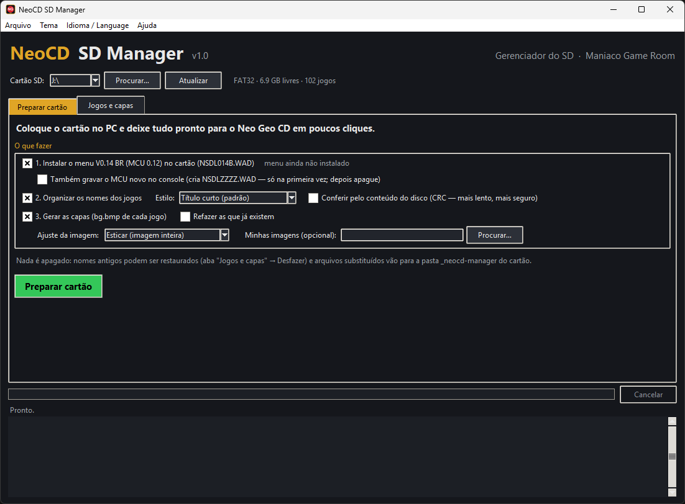
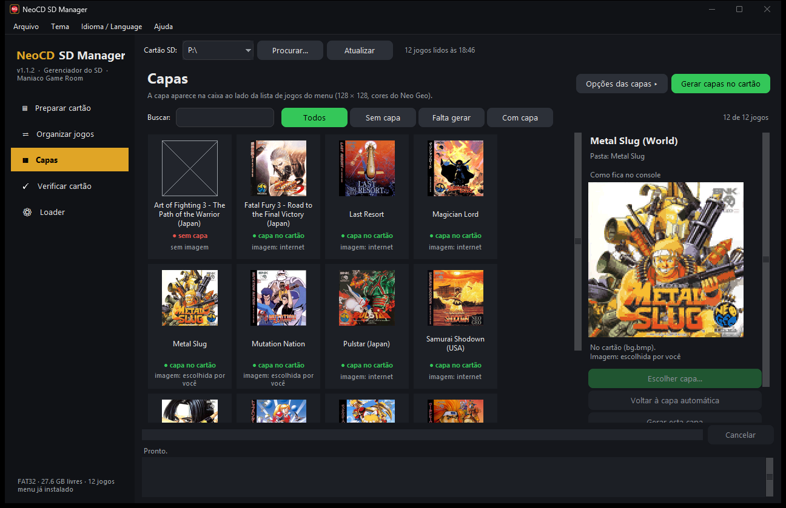
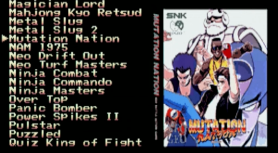
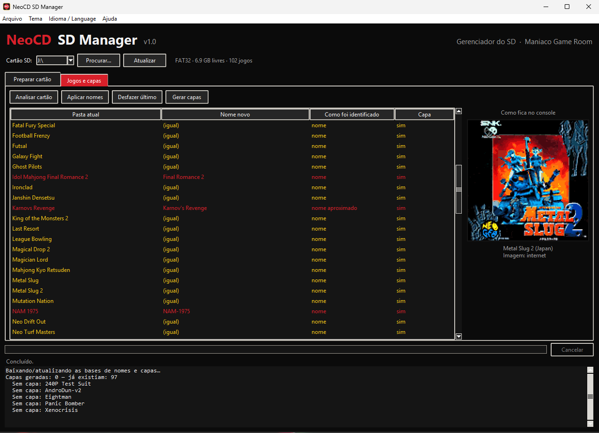
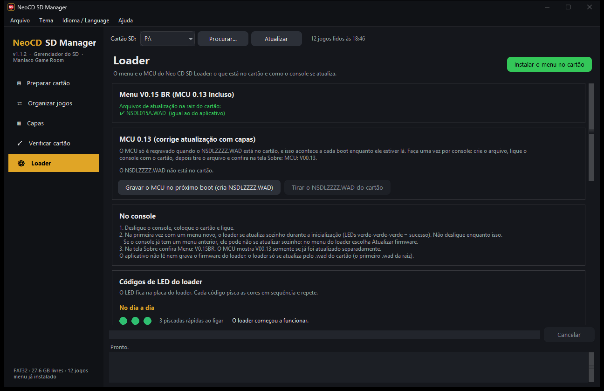
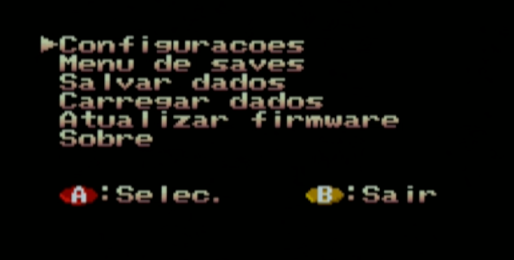
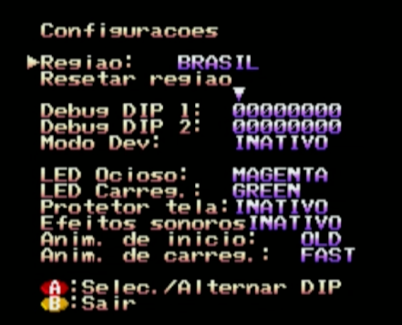

# NeoCD SD Manager

**[English](README.en.md)**

**Aplicativo para Windows que deixa o cartão SD do Neo Geo CD (Neo CD SD Loader — BR Edition) pronto em poucos cliques: instala o menu, copia os jogos do PC, dá o nome certo a cada jogo e gera a capa de cada um.**

Um projeto do site **[Maniaco Game Room](https://www.maniacogameroom.com.br/)**.

## Como funciona

Você coloca o cartão SD no PC, abre o aplicativo e clica em **Preparar cartão**. Ele:

1. **instala o menu BR Edition** no cartão (copia o arquivo de atualização `NSDL014D.WAD` e confere a cópia);
2. **copia jogos de uma pasta do PC**, convertendo `.chd`, `.ccd`, `.nrg`, `.iso` e `.zip` para o formato que o loader lê;
3. **organiza o nome dos jogos:** identifica cada pasta pelo nome (e, se você quiser, pelo conteúdo do disco, comparando com o banco Redump) e renomeia com o título certo, por exemplo `metal_slug_2 [!]` → `Metal Slug 2`;
4. **gera a capa de cada jogo** (`bg.bmp`), pronta para o console, usando as suas imagens ou baixando da internet.

| | |
|---|---|
|  |  |
|  |  |

**O menu no console:**

| | | |
|---|---|---|
|  |  |  |

- **Nada é apagado:** os nomes antigos podem ser restaurados (botão **Desfazer último**) e o que for substituído no cartão vai para a pasta `_neocd-manager`.
- **Prévia fiel:** ao clicar num jogo, você vê a capa como o console vai mostrar (cores reduzidas, mesmas paletas).
- **Português ou inglês:** menu **Idioma / Language**, com temas de cor para a janela. O menu do console também tem a opção **Idioma** (PT-BR ou English).

## Novidades da versão 1.1

- Janela nova, com barra lateral: **Preparar cartão**, **Organizar jogos**, **Capas**, **Verificar cartão** e **Loader**.
- **Capas com cores mais fiéis** (conversão nova, conferida no console) e uma janela **Escolher capa…** que busca imagens no libretro, no TheGamesDB, na versão cartucho e na Arcade Database.
- **Copiar jogos do PC** com conversão de `.chd`, `.ccd`, `.nrg`, `.toc`, `.iso`, `.bin` e `.zip`.
- **Verificar cartão:** acha o que o loader não lê e corrige o que é seguro.
- **Editar nome** e **não alterar** por jogo; **capa geral** do menu.
- Menu do console **`NSDL014D`**: seletor de idioma, capa escondida no menu de opções, cursor mantido na volta e nomes longos rolando em loop. Quem já tem o V0.14BR atualiza pela opção **Atualizar firmware** do menu ([tutorial](FIRMWARE.md#4-atualizar-um-console-que-já-tem-o-v014br)).
- Tela **Loader** com os códigos de LED, e aviso de atualização do próprio aplicativo.

## Como usar

1. Baixe o **`NeoCD-SD-Manager.exe`** na página de **[Releases](../../releases)**.
2. Coloque o cartão no PC (formatado em **FAT32**). Os jogos podem já estar no cartão (cada um em uma pasta com o `.cue`) ou numa pasta do PC.
3. Abra o aplicativo, escolha o cartão e clique em **Preparar cartão**.
4. Coloque o cartão no console e ligue.

Na primeira vez, o loader grava o menu novo (e o MCU, se você pediu). Quem já tem o menu V0.14BR usa **Atualizar firmware** no menu do loader. Passo a passo e códigos de LED: **[Como gravar o firmware](FIRMWARE.md)**.

Passo a passo completo, com todas as opções: **[Manual do aplicativo](MANUAL.md)**.

## Requisitos

- Neo Geo CD com o **Neo CD SD Loader** instalado (kit do Furrtek).
- Windows 10 ou 11.
- Cartão SD em **FAT32**, com até **200 jogos** (limite do menu). Para gravar o firmware, use um cartão de até 32 GB.
- Internet na primeira vez (bancos de nomes e capas são baixados e ficam guardados no PC).

## Aviso

Este projeto **não fornece jogos nem BIOS**. O arquivo de atualização do menu incluído (`NSDL014D.WAD`) é software livre (GPL) baseado no [Neo CD SD Loader de Furrtek](http://www.furrtek.org/sdloader/) e contém apenas os patches do loader, sem a BIOS do console. Este projeto não é afiliado à SNK nem a Furrtek. Use por sua conta e risco.

## Créditos

- Neo CD SD Loader (hardware, firmware e menu originais): **Furrtek** — [furrtek.org/sdloader](http://www.furrtek.org/sdloader/)
- Capas: [libretro-thumbnails](https://github.com/libretro-thumbnails), [TheGamesDB](https://thegamesdb.net/) (via [Hasheous](https://hasheous.org/)) e [Arcade Database](http://adb.arcadeitalia.net/)
- Conversão de discos: chdman do [MAME](https://www.mamedev.org/) (GPL)
- Bancos de jogos (Redump): [libretro-database](https://github.com/libretro/libretro-database)

## Licença

**Freeware — uso gratuito. © 2026 Maniaco Game Room. Todos os direitos reservados** (exceto o arquivo de atualização do menu, que é GPL). Veja a [licença](LICENCA.md) e os [componentes de terceiros](TERCEIROS.md).

Encontrou um problema? Abra uma [Issue](../../issues).
